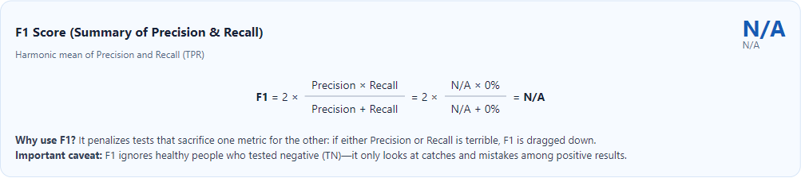
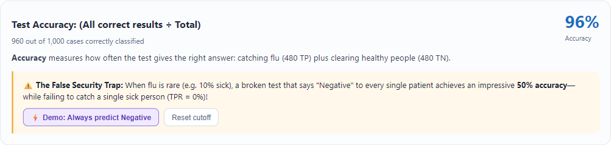
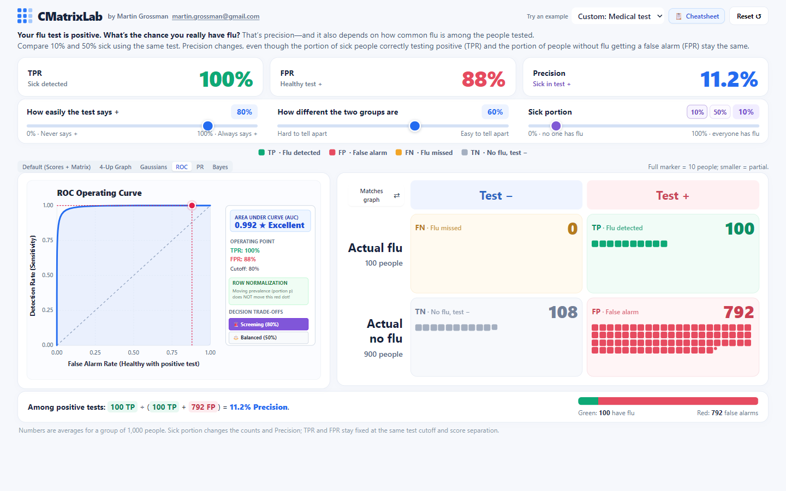

# CMatrixLab QA Report

Date: 25 October 2026 (Europe/Bratislava). Tested branch: `featursimple_bayes_story_overall_visual_GemFixes`. Commit: `4ad5b18ff465358ac25b538f50dc2e068f7cb644`.

## Executive summary

**Release readiness: NOT READY under the requested QA severity rubric.** The core weighted classifier and nondegenerate metrics are sound in the executed campaign. One mathematical edge-case defect in the preserved learning page, a contradictory teaching example, keyboard-accessibility failures, and responsive/usability issues remain. No application-breaking crash or console exception was observed.

The campaign found **10 defects plus one P3 enhancement**: one P0 mathematical edge case, two P1 teaching/accessibility issues, seven P2 issues, and one P3 keyboard refinement. P0 follows the supplied rubric for incorrect mathematical results; its scope is the F1 zero-detection case, not general corruption of simulator metrics.

Coverage accounting (overlapping campaigns are deliberately not summed):

- Existing `npm test`: **21 PASS, 0 FAIL, 0 SKIPPED**, plus 44,541 model combinations and the browser check script. Additional `scripts/p1.test.cjs`: **1 PASS**.
- Consolidated independent MCP inventory: **53 test groups — 41 PASS, 11 FAIL, 1 NOT IMPLEMENTED**. Reproductions share defect IDs; failed group count is not a unique bug count.
- Responsive campaign: **90 Chromium mode/viewport measurements** (13 requested sizes plus 2 short windows) and **78 WebKit mode/viewport measurements**. Every requested viewport has screenshots in both engines. Mixed viewport results are shown below.
- Supplemental WebKit functional checks: **78 PASS, 1 FAIL** across 79 checks (five presets plus pin/Escape at each requested size, and the F1 edge case).
- **3 BLOCKED** native browser zoom levels (125%,150%,200%); headless shortcut did not change actual zoom. All three were also tested using clearly identified CSS-zoom approximations.
- Four explicitly untested areas: physical devices/browser chrome, full screen-reader/contrast audit, OS print/export output, and long-duration memory/network-condition testing. Native tooltip placement is also unverified; hover linking and DOM explanations were tested.

83 screenshots were captured. Representative default/mobile/tablet, ROC, F1, accuracy-paradox and WebKit screenshots were visually inspected; all mode layouts also received DOM bounds/scroll/SVG checks. No production file was changed, and no commit or push was made.

## Environment and execution

| Item | Recorded value |
| --- | --- |
| Primary automation | Installed Playwright MCP; real Chromium156.0.8078.47 |
| Supplemental engine | Installed Playwright WebKit26.4, launched from isolated QA script; not Safari on a physical iPhone |
| Regression environment | Playwright1.59.1; installed Chromium147.0.7727.15; Node version/path details in environment.json |
| Target | http://localhost:8080/ and index.html, learn.html, reference.html, cheatsheet.html |
| Server | Reused the already running local repository server. Browser requests returned the current HTML (172,762-byte simulator); no duplicate listener was started. npm suite separately exercised createServer(). |
| Repository state | Target branch matched; clean tracked working tree before QA. Only test-results/ artifacts were added. |
| Documents reviewed | AGENT.md, README.md, CMatrixLab_CODE_GUIDE.md, teaching_review.md, package.json, QA prompt and actual HTML/JS/CSS. |

Most state sweeps used real browser input events dispatched on the actual native range inputs to obtain reproducible boundary states. Mechanical input behavior was separately tested using native keyboard keys, mouse dragging with pointer capture, touch-enabled Chromium events and taps. No production-only model hook or substituted renderer was used. The separate independent distribution calculation consumes values harvested from those executed browser states.

Two harness assumptions were corrected and rerun: M05 initially targeted nonexistent `#calculation-accuracy` and now uses `#liveAccuracyTop`; F16 initially assumed open categories and later overlooked persisted open details. Final corrected results pass. Original attempt logs are retained and are not counted as application bugs. Script display-title typos (“135 states”, “nine count sets”) were corrected in the saved harness; the actual executed loop totals are105 and10.

## Critical findings

| ID | Rank | Finding | Recommended effort |
| --- | --- | --- | --- |
| QA-01 | P0 | F1 is incorrectly undefined for a defined zero score | Small |
| QA-02 | P1 | Accuracy-paradox lesson contradicts its stated prevalence | Small |
| QA-03 | P1 | ROC decision presets are inaccessible with keyboard navigation | Small |
| QA-04 | P2 | Model separation slider has no accessible name | Small |
| QA-05 | P2 | ROC and PR cutoff captions use inverted sensitivity as cutoff | Small |
| QA-06 | P2 | Default primary dashboard exceeds short-phone/tablet viewports | Medium |
| QA-07 | P2 | Mobile hit areas fall below the project minimum | Medium |
| QA-08 | P2 | Precision-bar accessible summary retains flu terminology in other domains | Small |
| QA-09 | P2 | Generic ML Screening pill fails to show active state | Small |
| QA-10 | P2 | Trapezoidal PR-AUC is labeled Average Precision | Small |
| QA-11 | P3 | Enhancement: graph tabs lack arrow-key tab navigation | Small |

### QA-01 — P0: F1 is incorrectly undefined for a defined zero score

**Impact:** A learner sees N/A for a failed detector even though the displayed count definition is 2TP/(2TP+FP+FN)=0. The reference calculator correctly returns 0 for the same counts.

**Reproduce:** Open /learn.html → set positive portion to 10% → set the flu threshold/sensitivity slider to 0% (never says positive) → Formulas → F1. Repeat after reload.

**Observed / expected:** TP=0, FP=0, FN=100, TN=900; Learn F1=N/A. Expected F1=0 because 2TP+FP+FN=100. Reproduced twice in MCP Chromium and once in WebKit.

**Likely cause:** learn.html:1525 requires finite precision and a positive precision+recall sum. index.html:2371 has the same derived-metric guard, although dashboard F1 is not exposed.

**Recommended fix:** Compute F1 directly from counts: denominator=2*TP+FP+FN; return 2*TP/denominator when denominator>0, otherwise N/A. Add no-positive-prediction and all-wrong regression cases.

**Evidence:** [F1 detail](screenshots/f1-zero-detail.png), [WebKit detail](screenshots/webkit-f1-zero.png), M06/M04 in math-education-results.json.

### QA-02 — P1: Accuracy-paradox lesson contradicts its stated prevalence

**Impact:** The central rare-event lesson teaches the wrong numeric implication on the untouched learning page.

**Reproduce:** Open /learn.html fresh → Basics → scroll to “Overall Accuracy & The False Security Trap”. Repeat after Reset.

**Observed / expected:** Text says “10% sick” but “50% accuracy” for always-negative predictions. At 10% sick this is 90%; 50% is the result at the current default 50% prevalence. Reproduced twice.

**Likely cause:** learn.html:2173 mixes a fixed 10% example with formatPercent(1-p), where p comes from live settings.

**Recommended fix:** Either use the live prevalence in the sentence or calculate the complete fixed-10% example separately. Keep the one-click demonstration and explanation aligned.

**Evidence:** [Accuracy detail](screenshots/accuracy-paradox-detail.png), E06 in math-education-results.json.

### QA-03 — P1: ROC decision presets are inaccessible with keyboard navigation

**Impact:** Keyboard-only users cannot activate the on-chart Screening/Balanced controls. Equivalent main sliders are usable, but the implemented shortcuts are not.

**Reproduce:** Desktop simulator → ROC → focus the ROC tab → press Tab through the page (25 presses tested) → try to reach Screening/Balanced.

**Observed / expected:** Focus bypasses both pills; each is a click-only SVG g with no tabindex or button role. Reproduced twice; mouse activation works.

**Likely cause:** index.html:3298–3321 creates SVG groups with click listeners only.

**Recommended fix:** Use HTML buttons or add keyboard-focusable button semantics and Enter/Space handlers, plus a visible focus indicator.

**Evidence:** A03 in pages-robustness-results.json; A04 in rechecks-final-results.json; [ROC UI](screenshots/bug-cutoff-label.png).

### QA-04 — P2: Model separation slider has no accessible name

**Impact:** A screen reader announces an unnamed slider, hiding which model property it changes.

**Reproduce:** Open simulator → inspect the accessibility snapshot or focus the second native range control. Repeat after reload.

**Observed / expected:** #separation has zero associated labels and no aria-label, aria-labelledby or title; the snapshot reports only “slider”. Reproduced twice.

**Likely cause:** index.html:1787–1793 uses a visual span without an input label association.

**Recommended fix:** Associate the domain-specific separation label with the input using label/for or aria-labelledby.

**Evidence:** [Accessibility snapshot](final-accessibility-snapshot.yml), A01/A04 raw JSON records.

### QA-05 — P2: ROC and PR cutoff captions use inverted sensitivity as cutoff

**Impact:** The charts give conflicting numeric descriptions of the same operating threshold outside Generic ML mode.

**Reproduce:** Medical simulator → ROC → click Screening (80%). The same caption convention is present in PR. Repeat after Reset.

**Observed / expected:** Model sensitivity=80% means conventional positive-score cutoff=.20 (score line x=272 with left=190,width=410), but ROC says “Cutoff: 80%”. Reproduced twice. Generic cutoff mapping itself is correct.

**Likely cause:** index.html:3121 and 3279 print elements.threshold.value directly; readSettings() at 2239–2248 inverts it outside generic mode.

**Recommended fix:** Render the effective threshold argument consistently, or explicitly label the raw control percentage as sensitivity/aggressiveness.

**Evidence:** [Wrong cutoff caption](screenshots/bug-cutoff-label.png), G01 in pages-robustness-results.json and cutoff in final-validation-results.json.

### QA-06 — P2: Default primary dashboard exceeds short-phone/tablet viewports

**Impact:** Parts of the matrix or summary require scrolling, contradicting AGENT.md’s primary single-viewport requirement; input and outcomes cannot always be seen together.

**Reproduce:** Fresh simulator at 320×568,375×667,768×1024 or1024×768 → Default. Do not scroll. Reload and repeat.

**Observed / expected:** Chromium document heights are approximately770/722/1203/1138px respectively. At320×568 matrix bottom≈671; at1024×768 matrix bottom≈1041. Reproduced twice and observed in WebKit. 4-Up mobile scroll is separately intentional in source/tests and is a design exception, not a broken swipe feature.

**Likely cause:** index.html:901–911 stacks panels at tablet widths; fixed component minima and narrative/row sizes consume more than available height. Mobile4-Up explicitly sets overflow-y:auto at1661–1663.

**Recommended fix:** Introduce a height-aware pinned/tabs layout for primary mobile/tablet content. Decide whether documented one-viewport rules should explicitly exempt 4-Up. Preserve intentional scrolling on long secondary pages.

**Evidence:** [320px default](screenshots/chromium-320x568-default.png), [tablet default](screenshots/chromium-1024x768-default.png), V01 and responsive JSON matrices.

### QA-07 — P2: Mobile hit areas fall below the project minimum

**Impact:** Closely packed tiny controls are harder to tap reliably, particularly graph tabs and reset.

**Reproduce:** Set390×844 → inspect/tap graph tabs, balance buttons, native ranges, scenario selector and Reset. Bounding boxes measured on the normal page and across the viewport sweep.

**Observed / expected:** Tabs are16px high; selector≈92×18.4; Reset≈20.4×28; balance buttons≈35.8×23.35; ranges28px high. No larger pseudo-element hit padding was found. The project requires44×44.

**Likely cause:** index.html:1271,1357,1634,1673–1674 enforce compact control sizes. Selector font is10px; native iOS focus autozoom was not verified.

**Recommended fix:** Provide at least44×44 effective hit areas with enough separation, retaining dense visual styling where useful. Use16px mobile form text if native-focus zoom is a target constraint.

**Evidence:** V02 in rechecks-final-results.json; controls and computed styles in responsive-results.json; [mobile screenshot](screenshots/webkit-390x844-default.png).

### QA-08 — P2: Precision-bar accessible summary retains flu terminology in other domains

**Impact:** Assistive-technology users hear incorrect domain meaning for cars, spam and fraud.

**Reproduce:** Select Car braking, Spam filter or Fraud detection → inspect the precision-bar accessible label. Repeat the three selections.

**Observed / expected:** Labels include “150 people with flu”, “344 people with flu” and “9.6 people with flu” instead of detected obstacles, spam or fraud cases. Each reproduced twice.

**Likely cause:** index.html:3591 selects only generic versus flu wording, ignoring activeDomain and copy.bar/copy.subject.

**Recommended fix:** Construct the accessible description from the active scenario terminology and weighted outcome counts.

**Evidence:** E07 in math-education-results.json; [fraud UI](screenshots/bug-domain-summary.png).

### QA-09 — P2: Generic ML Screening pill fails to show active state

**Impact:** The shortcut changes the model but its styling gives no confirmation of the chosen preset.

**Reproduce:** Select Generic ML → ROC → click Screening(80%). Repeat after a fresh navigation.

**Observed / expected:** Threshold correctly becomes20%; neither Screening nor Balanced has the active purple fill. Reproduced twice.

**Likely cause:** index.html:3300 compares the generic threshold(.20) against the sensitivity preset(.80), while the click handler converts80→20.

**Recommended fix:** Compare values in the same coordinate convention, e.g. compare threshold to1−targetCutoff/100 in generic mode.

**Evidence:** G02 in rechecks-final-results.json; [active-state failure](screenshots/bug-generic-cost-active.png).

### QA-10 — P2: Trapezoidal PR-AUC is labeled Average Precision

**Impact:** Learners may assume the numerical area is the discrete AP statistic, despite the reference correctly explaining their difference.

**Reproduce:** Desktop simulator → PR → read the “PR-AUC (AVG PRECISION)” badge. Repeat after reload.

**Observed / expected:** Badge conflates two statistics. The independently checked number is a continuous-model PR integral approximated by trapezoids, not discrete step-weighted AP.

**Likely cause:** index.html:3113 labels it AVG PRECISION, while3067–3075 use trapezoidal integration. reference.html’s Average precision entry correctly distinguishes AP.

**Recommended fix:** Rename badge “PR-AUC (trapezoidal)” and document that curves use the continuous Gaussian model. Calculate/display AP separately only if implemented.

**Evidence:** E08 in rechecks-final-results.json; [badge](screenshots/pr-auc-label.png); M07 verifies the area itself.

### QA-11 — P3: Enhancement: graph tabs lack arrow-key tab navigation

**Impact:** Tab and Enter remain usable, but arrow keys do not move between graph tabs as users may expect.

**Reproduce:** Focus Default graph tab → press ArrowRight. Focus and selection stay on Default; Tab moves onward normally.

**Observed / expected:** Observed in A02. This is a missing keyboard refinement, not a failure of ordinary Tab/Enter navigation.

**Likely cause:** index.html:1852–1857 declares tab roles; graph-view handlers implement click selection without arrow-key focus movement.

**Recommended fix:** Add roving focus and left/right/Home/End behavior to the graph tablist.

**Evidence:** A02 in pages-robustness-results.json; visible focus outline recorded.

## Functional test matrix

Default browser/viewport is MCP Chromium1440×900 unless the row or linked evidence specifies otherwise. Mobile touch is390×844; detailed viewport tests follow. Raw logs contain exact inputs, counts, arrays, styles and state transitions. PASS means the stated check ran successfully; discovery of an absent feature is marked separately.

| ID | Status | Test / expected behavior | Actual result |
| --- | --- | --- | --- |
| F01 | PASS | Each scenario loads its settings and domain terms | All five presets selected; totals 1,000. See preset table. |
| F02 | PASS | Arrow key changes range and marks scenario Custom | Car context retained; selection becomes Custom. |
| F03 | PASS | Balance changes counts/precision, preserves conditional rates | 10% ↔ 50% retains cutoff/separation, TPR 96% and FPR 4%. |
| M01 | PASS | Weighted sums, marker weights and rate formulas match | 105 rendered states pass; full matrix in core-results.json. |
| M02 | PASS | Higher conventional cutoff cannot raise TPR/FPR | 21 cutoffs 0–100 at 5-point intervals pass. |
| M03 | PASS | Fixed TPR/FPR and Bayes PPV as prevalence varies | 1/10/50/99% prevalence passes; 1% gives 19.5% PPV. |
| F04 | PASS | Layouts preserve statistics and correct TP/FP precision outlines | Graph/scikit/standard cycle passes; includes outlined regions. |
| F05 | PASS | View changes preserve counts; SVG coordinates stay finite | All six modes pass at desktop. |
| F06 | PASS | Hover/focus previews; Enter pins; Escape clears | TPR/FPR/Precision include exactly their denominator outcomes. |
| F07 | PASS | Matching dot/square share hover focus | Both directions verified using shared data-id. |
| F08 | PASS | Captured drag updates cutoff and clamps outside SVG | Right/left extremes clamp to sensitivity 0/100. |
| F09 | PASS | Home/End/arrows/Page keys update the graph cutoff | All six keys executed and endpoints checked. |
| F10 | PASS | Group gesture adjusts a model control | Long diagonal drag changes separation; axis locking retained. |
| F11 | PASS | Reset is repeatable and clears pinned metrics | Three repetitions restore Medical [50,60,10]. |
| F12 | PASS | Observe refresh, without assuming persistence exists | Defaults restored; persistence is absent, not a broken implemented feature. |
| F13 | NOT IMPLEMENTED | Discover optional panel drag/resize | Dragging header/corner leaves panel position/size unchanged; no widget handles. |
| M04 | PASS | Eight calculator metrics match independent count formulas | Ten count sets (80 displayed results), including empty/all-wrong/perfect/rare cases, pass. |
| F14 | PASS | Presets/metric buttons/invalid counts are handled | Six presets, eight metric buttons, negative/fractional/blank/unsafe-integer inputs exercised. |
| E01 | PASS | All educational tabs and terminology toggle work | Basics/Formulas/Bayes/Trade-offs populated and toggle works. |
| M05 | PASS | Learn values match independent weighted-count formulas | TPR/FPR/PPV/TNR/NPV/FNR/accuracy/F1 pass at prevalence 37%. |
| E02 | PASS | Formula parts include only their intended matrix outcomes | Six metrics × numerator/denominator = 12 verified selections. |
| E03 | PASS | Always-negative demo gives zero recall and ≥90% accuracy | Demo moves prevalence to 10%, reports 0% TPR/90% accuracy; reset cutoff works. |
| M06 | FAIL | F1=0 when TP=FP=0 and FN>0 | FAIL: N/A for [TP=0,FP=0,FN=100,TN=900], twice; WebKit agrees. QA-01. |
| E04 | PASS | Bayes posterior equals TP/(TP+FP), including edge cases | 1/10/50/0/100% and 10/50 comparison buttons pass. |
| E05 | PASS | Cost presets and synchronized controls update all views | Screening 80 / balanced 50 / conservative 20 and synchronized separation pass. |
| E06 | FAIL | Example prevalence and accuracy agree | FAIL: “10% sick” example claims 50% accuracy on fresh Learn load. QA-02. |
| M07 | PASS | AUC values match independently integrated continuous model | 12 separation/prevalence pairs pass ROC and PR tolerances. |
| M08 | PASS | Curve operating points use same counts as matrix | ROC(FPR,TPR), PR(TPR,PPV), Bayes(p,PPV) SVG coordinates pass. |
| E07 | FAIL | Scenario accessible text uses the selected domain | FAIL: car/spam/fraud precision bar announces “people with flu”, twice each. QA-08. |
| F15 | PASS | Cheatsheet filters, folding, empty/reset work | Search, ranking category, collapse/expand and empty result recovery pass. |
| F16 | PASS | Reference filtering/disclosures/related links work | Five categories, search, both fold controls, related metric and empty reset pass after harness correction. |
| F17 | PASS | Industry links expose scenario context | All discovered data-scenario values clicked and resulting context captured. |
| F18 | PASS | Internal links resolve to intended pages | Simulator→cheatsheet→reference→simulator; Learn→simulator pass. |
| F19 | PASS | Print action calls print and restores disclosure state | Stub records print invocation; beforeprint expands, afterprint restores. OS dialog/export not verified. |
| A01 | FAIL | Ranges have accessible names | FAIL: #separation has no label, aria-label, aria-labelledby or title. QA-04. |
| A02 | PASS | Keyboard traversal and visible focus remain usable | Tab/focus outline recorded; arrow-key tab switching absent (P3 enhancement QA-11). |
| A03 | FAIL | ROC cost presets usable without a mouse | FAIL: 25 Tab presses never reach either click-only SVG pill. QA-03. |
| G01 | FAIL | “Cutoff” label shows effective conventional score threshold | FAIL: sensitivity 80% gives score cutoff .20 but ROC/PR says “Cutoff: 80%”. QA-05. |
| R01 | PASS | Rapid updates leave finite, coherent charts | 150 slider events +20 preset/view switches; no invalid SVG. |
| R02 | PASS | Resize preserves model and interruption recovers | 1440→390→1440 retains summary; view change during captured drag then reset succeeds. |
| P01 | PASS | Measure real local page-load timing | Five navigations; DOM/load/paint samples recorded. |
| T01 | PASS | Touch drag/pinning/swipe work in a touch-enabled context | Real Chromium CDP touch events move cutoff; tap toggles pin; 4-Up vertical swipe scrolls. |
| A04 | FAIL | Reproduce missing-name/cost-keyboard failures | Both accessibility findings reproduced twice; supports QA-03/04. |
| E08 | FAIL | PR integral is not mislabeled as Average Precision | FAIL: desktop says “PR-AUC (AVG PRECISION)” despite trapezoidal integral. QA-10. |
| G02 | FAIL | Clicked Generic ML cost pill has active styling | FAIL: Screening sets cutoff20 but neither pill remains active, twice. QA-09. |
| V01 | FAIL | Primary dashboard satisfies documented one-viewport goal | FAIL at 320×568,375×667,768×1024,1024×768 on repeated fresh loads. QA-06. |
| V02 | FAIL | Interactive hit areas meet project 44×44 minimum | FAIL: tabs16px high, ranges28px high, selector18.4px high, reset20.4×28. QA-07. |
| M09 | PASS | Reference worked examples agree with independent arithmetic | 33 numerical worked examples recomputed from browser-rendered text; two ranking examples reviewed conceptually. |
| V03 | PASS | Secondary pages have no horizontal overflow | 24 page/tab checks across 320/390/768/1440 widths pass; long-page vertical scroll is intentional. |
| P02 | PASS | Measure sustained real pointer-drag frame timing | 90 mouse moves over ~2.2s; timing samples recorded. |
| B01 | PASS | No runtime errors/failed requests during campaign | No errors in instrumented MCP page; supplemental WebKit also clean. |
| M10 | PASS | Model generation independently matches sampled quantile counts | Normal CDF via Simpson integration; all 105 previously executed browser states match. |
| R03 | PASS | All graph modes handle empty classes/cutoff extremes | 36 combinations pass; undefined ratios show N/A, no malformed SVG or literal NaN/Infinity. |

### Scenario results

Slider order: raw threshold/sensitivity / separation / positive prevalence (%). Counts retain weights; visible integer matrix labels can legitimately round.

| Scenario | Sliders | TP / FP / FN / TN | TPR | FPR | Precision | Status |
| --- | --- | --- | --- | --- | --- | --- |
| balanced | 50 / 60 / 10 | 96 / 36 / 4 / 864 | 96% | 4% | 72.7% | PASS |
| car | 60 / 70 / 15 | 150 / 102 / 0 / 748 | 100% | 12% | 59.5% | PASS |
| spam | 45 / 55 / 40 | 344 / 12 / 56 / 588 | 86% | 2% | 96.6% | PASS |
| fraud | 50 / 60 / 1 | 9.6 / 39.6 / 0.4 / 950.4 | 96% | 4% | 19.5% | PASS |
| generic | 50 / 60 / 50 | 480 / 20 / 20 / 480 | 96% | 4% | 96% | PASS |

The car scenario’s preset is15% prevalence,60% sensitivity,70% separation; its TPR100%, FPR12% and precision59.5% agree with independent count arithmetic. The fraud preset has9.6TP and39.6FP despite integer matrix labels10 and40; its19.5% precision correctly uses unrounded weights.

### Missing features and documentation discrepancies

- Panel/widget dragging and resizing: **NOT IMPLEMENTED**. Attempts were executed; no dashboard handles or movement exist. Graph group/threshold dragging is implemented and passes.
- Layout/model persistence and URL-state sharing: **NOT IMPLEMENTED**. Refresh restores defaults. This is not treated as a regression because current source/README do not promise persistence; the teaching review lists URL state as backlog.
- Dedicated persona/currency-cost editor, direct per-cell count editing on the simulator and the specified pinned Metrics/Executive/Formulas mobile layout are absent. The separate reference calculator does support count entry. These are design/documentation gaps rather than broken implemented controls.
- Learn is intentionally unlinked and was opened directly. The simulator has one live cheatsheet link and zero direct Reference links at390px and1440px; Reference is reachable through Cheatsheet. README’s statement that Reference remains linked directly from the simulator is stale.
- teaching_review.md describes six scenarios, a separate Flu Screening option and a50/50 medical default. Current source exposes five scenarios and starts medical at10%. It also describes32 metrics; the actual reference and cheatsheet expose35. AGENT.md’s proposed React/Tailwind architecture and mobile split are not the present standalone implementation.
- Mobile4-Up intentionally stacks four graphs and permits vertical swipes; source and regression tests explicitly support scrolling. This is called out against the documented primary single-viewport goal, not mislabeled as a broken touch feature. Long learn/reference/cheatsheet pages intentionally scroll.

## Mathematical validation

Independent formulas used: accuracy=(TP+TN)/N; balanced accuracy=(TPR+TNR)/2; PPV=TP/(TP+FP); TPR=TP/(TP+FN); TNR=TN/(TN+FP); FPR=FP/(FP+TN); FNR=FN/(TP+FN); NPV=TN/(TN+FN); F1=2TP/(2TP+FP+FN); MCC=(TP·TN−FP·FN)/sqrt((TP+FP)(TP+FN)(TN+FP)(TN+FN)). Denominator-zero results are checked as undefined; a zero numerator with a positive denominator is a defined zero.

The 105 browser states cover separation0/60/100%, prevalence0/1/10/37/50/99/100%, and conventional cutoff0/25/50/75/100%. They verify sum1,000; class totals; weighted marker sums in both charts; sample-based conditional rates; displayed percentages; empty classes; all-positive/all-negative predictions; and perfect separation at midpoint. A separate normal-CDF Simpson integrator and quantile-count calculation reproduces all105 expected confusion matrices without calling application functions.

Tolerance: weighted counts1e-7 in the browser harness (1e-6 for independently reconstructed distributions); displayed rate tolerance0.051 percentage points; calculator0.0501 percentage points and MCC0.00051; independently integrated ROC-AUC0.00051 and PR-AUC0.0015. Legitimate count/rate rounding is not a defect.

| Metric | Independent expected: [32,8,12,48] | Observed | Status |
| --- | --- | --- | --- |
| accuracy | 0.800000 | 80.0% | PASS |
| f1 | 0.761905 | 76.2% | PASS |
| precision | 0.800000 | 80.0% | PASS |
| recall | 0.727273 | 72.7% | PASS |
| specificity | 0.857143 | 85.7% | PASS |
| balancedAcc | 0.792208 | 79.2% | PASS |
| mcc | 0.592157 | 0.592 | PASS |
| fpr | 0.142857 | 14.3% | PASS |

Additional learned values at prevalence37%: TP355.2, FP25.2, FN14.8, TN604.8; TPR96%, FPR4%, TNR96%, FNR4%, accuracy96%, PPV93.375394%, NPV97.611362%, F1≈0.946695. The displayed values agree within rounding.

The reference calculator independently passed ten count sets ×eight metrics, including MCC−1 for entirely reversed labels, perfect classification, zero cases, no predicted positives, and rare-event cases. F1 for[0,0,10,990] correctly shows0.0% there; the Learn discrepancy is QA-01. NPV/FNR are validated on the learning page. Other reference-only definitions (F-beta/F2/F0.5, G-mean, Youden J, kappa, IoU, markedness, FDR/FOR, error rate, Fowlkes–Mallows, diagnostic odds ratio, AP, log loss, Brier and operational/time/track measures) were read from all35 rendered entries and33 numerical examples independently recomputed (M09); these are static definitions, not live simulator calculators.

### Independently integrated curve values

ROC-AUC is the Gaussian pairwise-ranking probability, integrated independently via a normal CDF. PR-AUC is integrated over recall using an independent numerical normal integral (4,000 Simpson intervals over z=−8…8). These are continuous Gaussian-model summaries; the operating point uses the finite weighted quantile sample matrix. They are not claimed to be exact empirical step curves or discrete AP. The area values passed; the AP caption does not.

| Separation | Prevalence | Expected ROC-AUC | Actual ROC-AUC | Expected PR-AUC | Actual PR-AUC | Status |
| --- | --- | --- | --- | --- | --- | --- |
| 0% | 1% | 0.500000 | 0.500 | 0.010000 | 0.010 | PASS |
| 0% | 10% | 0.500000 | 0.500 | 0.100000 | 0.100 | PASS |
| 0% | 50% | 0.500000 | 0.500 | 0.500000 | 0.500 | PASS |
| 30% | 1% | 0.830713 | 0.831 | 0.086350 | 0.087 | PASS |
| 30% | 10% | 0.830713 | 0.831 | 0.420877 | 0.421 | PASS |
| 30% | 50% | 0.830713 | 0.831 | 0.827668 | 0.828 | PASS |
| 60% | 1% | 0.991836 | 0.992 | 0.803101 | 0.803 | PASS |
| 60% | 10% | 0.991836 | 0.992 | 0.951123 | 0.951 | PASS |
| 60% | 50% | 0.991836 | 0.992 | 0.992017 | 0.992 | PASS |
| 100% | 1% | 1.000000 | 1.000 | 1.000000 | 1.000 | PASS |
| 100% | 10% | 1.000000 | 1.000 | 1.000000 | 1.000 | PASS |
| 100% | 50% | 1.000000 | 1.000 | 1.000000 | 1.000 | PASS |

Bayes PPV was independently checked as p·TPR/(p·TPR+(1−p)·FPR), matching direct TP/(TP+FP). At TPR96%/FPR4%, moving prevalence1%→10%→50% yields PPV19.5122%→72.7273%→96%; TPR/FPR stay fixed. Conventional cutoff raises never increase either rate. SVG point coordinates for ROC, PR and Bayes agree with the same counts. Empty-class boundaries and all six views were also exercised (R03).

## Browser and responsive layout matrix

Each cell assesses the documented single-viewport goal using actual scroll dimensions with a1px tolerance, plus the mode’s finite SVG coordinates. **FAIL(vertical)** means the document requires vertical scrolling; it does not imply a crash. In phone4-Up this scrolling is intentional implementation behavior. Other=Gaussians/ROC/PR/Bayes, shown separately. Horizontal overflow checks passed at every requested unzoomed simulator size in both engines.

| Engine | Viewport | Default | 4-Up | Gaussians | ROC | PR | Bayes | No horizontal overflow | Screenshots |
| --- | --- | --- | --- | --- | --- | --- | --- | --- | --- |
| Chromium MCP | 320×568 | FAIL (vertical) | FAIL (vertical) | FAIL (vertical) | FAIL (vertical) | FAIL (vertical) | FAIL (vertical) | PASS | [Default](screenshots/chromium-320x568-default.png) · [4-Up](screenshots/chromium-320x568-4up.png) |
| Chromium MCP | 375×667 | FAIL (vertical) | FAIL (vertical) | FAIL (vertical) | FAIL (vertical) | FAIL (vertical) | FAIL (vertical) | PASS | [Default](screenshots/chromium-375x667-default.png) · [4-Up](screenshots/chromium-375x667-4up.png) |
| Chromium MCP | 390×844 | PASS | FAIL (vertical) | PASS | PASS | PASS | PASS | PASS | [Default](screenshots/chromium-390x844-default.png) · [4-Up](screenshots/chromium-390x844-4up.png) |
| Chromium MCP | 402×874 | PASS | FAIL (vertical) | PASS | PASS | PASS | PASS | PASS | [Default](screenshots/chromium-402x874-default.png) · [4-Up](screenshots/chromium-402x874-4up.png) |
| Chromium MCP | 430×932 | PASS | FAIL (vertical) | PASS | PASS | PASS | PASS | PASS | [Default](screenshots/chromium-430x932-default.png) · [4-Up](screenshots/chromium-430x932-4up.png) |
| Chromium MCP | 360×800 | PASS | FAIL (vertical) | PASS | PASS | PASS | PASS | PASS | [Default](screenshots/chromium-360x800-default.png) · [4-Up](screenshots/chromium-360x800-4up.png) |
| Chromium MCP | 412×915 | PASS | FAIL (vertical) | PASS | PASS | PASS | PASS | PASS | [Default](screenshots/chromium-412x915-default.png) · [4-Up](screenshots/chromium-412x915-4up.png) |
| Chromium MCP | 768×1024 | FAIL (vertical) | FAIL (vertical) | FAIL (vertical) | FAIL (vertical) | FAIL (vertical) | FAIL (vertical) | PASS | [Default](screenshots/chromium-768x1024-default.png) · [4-Up](screenshots/chromium-768x1024-4up.png) |
| Chromium MCP | 1024×768 | FAIL (vertical) | PASS | FAIL (vertical) | FAIL (vertical) | FAIL (vertical) | FAIL (vertical) | PASS | [Default](screenshots/chromium-1024x768-default.png) · [4-Up](screenshots/chromium-1024x768-4up.png) |
| Chromium MCP | 1366×768 | PASS | PASS | PASS | PASS | PASS | PASS | PASS | [Default](screenshots/chromium-1366x768-default.png) · [4-Up](screenshots/chromium-1366x768-4up.png) |
| Chromium MCP | 1440×900 | PASS | PASS | PASS | PASS | PASS | PASS | PASS | [Default](screenshots/chromium-1440x900-default.png) · [4-Up](screenshots/chromium-1440x900-4up.png) |
| Chromium MCP | 1920×1080 | PASS | PASS | PASS | PASS | PASS | PASS | PASS | [Default](screenshots/chromium-1920x1080-default.png) · [4-Up](screenshots/chromium-1920x1080-4up.png) |
| Chromium MCP | 2560×1440 | PASS | PASS | PASS | PASS | PASS | PASS | PASS | [Default](screenshots/chromium-2560x1440-default.png) · [4-Up](screenshots/chromium-2560x1440-4up.png) |
| Chromium MCP | 1440×500 | FAIL (vertical) | FAIL (vertical) | FAIL (vertical) | FAIL (vertical) | FAIL (vertical) | FAIL (vertical) | PASS | [Default](screenshots/chromium-1440x500-default.png) · [4-Up](screenshots/chromium-1440x500-4up.png) |
| Chromium MCP | 800×400 | FAIL (vertical) | FAIL (vertical) | FAIL (vertical) | FAIL (vertical) | FAIL (vertical) | FAIL (vertical) | PASS | [Default](screenshots/chromium-800x400-default.png) · [4-Up](screenshots/chromium-800x400-4up.png) |
| WebKit | 320×568 | FAIL (vertical) | FAIL (vertical) | FAIL (vertical) | FAIL (vertical) | FAIL (vertical) | FAIL (vertical) | PASS | [Default](screenshots/webkit-320x568-default.png) · [4-Up](screenshots/webkit-320x568-4up.png) |
| WebKit | 375×667 | FAIL (vertical) | FAIL (vertical) | FAIL (vertical) | FAIL (vertical) | FAIL (vertical) | FAIL (vertical) | PASS | [Default](screenshots/webkit-375x667-default.png) · [4-Up](screenshots/webkit-375x667-4up.png) |
| WebKit | 390×844 | PASS | FAIL (vertical) | PASS | PASS | PASS | PASS | PASS | [Default](screenshots/webkit-390x844-default.png) · [4-Up](screenshots/webkit-390x844-4up.png) |
| WebKit | 402×874 | PASS | FAIL (vertical) | PASS | PASS | PASS | PASS | PASS | [Default](screenshots/webkit-402x874-default.png) · [4-Up](screenshots/webkit-402x874-4up.png) |
| WebKit | 430×932 | PASS | FAIL (vertical) | PASS | PASS | PASS | PASS | PASS | [Default](screenshots/webkit-430x932-default.png) · [4-Up](screenshots/webkit-430x932-4up.png) |
| WebKit | 360×800 | PASS | FAIL (vertical) | PASS | PASS | PASS | PASS | PASS | [Default](screenshots/webkit-360x800-default.png) · [4-Up](screenshots/webkit-360x800-4up.png) |
| WebKit | 412×915 | PASS | FAIL (vertical) | PASS | PASS | PASS | PASS | PASS | [Default](screenshots/webkit-412x915-default.png) · [4-Up](screenshots/webkit-412x915-4up.png) |
| WebKit | 768×1024 | FAIL (vertical) | FAIL (vertical) | FAIL (vertical) | FAIL (vertical) | FAIL (vertical) | FAIL (vertical) | PASS | [Default](screenshots/webkit-768x1024-default.png) · [4-Up](screenshots/webkit-768x1024-4up.png) |
| WebKit | 1024×768 | FAIL (vertical) | PASS | FAIL (vertical) | FAIL (vertical) | FAIL (vertical) | FAIL (vertical) | PASS | [Default](screenshots/webkit-1024x768-default.png) · [4-Up](screenshots/webkit-1024x768-4up.png) |
| WebKit | 1366×768 | PASS | PASS | PASS | PASS | PASS | PASS | PASS | [Default](screenshots/webkit-1366x768-default.png) · [4-Up](screenshots/webkit-1366x768-4up.png) |
| WebKit | 1440×900 | PASS | PASS | PASS | PASS | PASS | PASS | PASS | [Default](screenshots/webkit-1440x900-default.png) · [4-Up](screenshots/webkit-1440x900-4up.png) |
| WebKit | 1920×1080 | PASS | PASS | PASS | PASS | PASS | PASS | PASS | [Default](screenshots/webkit-1920x1080-default.png) · [4-Up](screenshots/webkit-1920x1080-4up.png) |
| WebKit | 2560×1440 | PASS | PASS | PASS | PASS | PASS | PASS | PASS | [Default](screenshots/webkit-2560x1440-default.png) · [4-Up](screenshots/webkit-2560x1440-4up.png) |

Top range controls remained keyboard-operable after each of the90 MCP view/viewport transitions. DOM measurements checked visible controls, small hit areas, out-of-viewport elements and SVG text bounds; no SVG text escaped its own visible SVG bounds in those samples. Representative screenshots were inspected for wrapping and readability. In short/default layouts the matrix/summary may sit below the viewport even when top controls remain visible. See QA-06/07 rather than interpreting “keyboard usable” as full-screen visibility.

At768×1024 and1024×768 the desktop/tablet breakpoint stacks large full-width panels; large unused horizontal chart space accompanies vertical overflow. At320×568 some matrix outcomes are below the fold. Chromium’s desktop scrollbars reduce the layout width by≈15px where scrolling occurs; touch WebKit has different scrollbar/font geometry. WebKit occasionally measures a1px footer overrun in desktop4-Up, accepted by the documented tolerance.

Secondary-page checks:24 tab/page combinations across320×568,390×844,768×1024,1440×900 passed horizontal overflow testing. All four Learn tabs were tested at each size. Screenshots for each page/size are in the evidence directory. Their long-page vertical scrolling is intentional.

### Zoom and short-height testing

| Check | Status | Actual result |
| --- | --- | --- |
| Native browser zoom125% | BLOCKED | Headless Control++ did not change DPR or innerWidth. |
| Native browser zoom150% | BLOCKED | Same unavailable native zoom capability; no claim of real150% test. |
| Native browser zoom200% | BLOCKED | Same unavailable native zoom capability; no claim of real200% test. |
| CSS body zoom 125% (approximation) | FAIL (reflow/viewport goal) | Scroll1425×1022; horizontal=false, vertical=true. [Screenshot](screenshots/chromium-css-zoom-1.25.png) |
| CSS body zoom 150% (approximation) | FAIL (reflow/viewport goal) | Scroll1425×1271; horizontal=false, vertical=true. [Screenshot](screenshots/chromium-css-zoom-1.5.png) |
| CSS body zoom 200% (approximation) | FAIL (reflow/viewport goal) | Scroll1819×1841; horizontal=true, vertical=true. [Screenshot](screenshots/chromium-css-zoom-2.png) |
| Short1440×500 /800×400 | FAIL (viewport goal) | All six views require vertical scrolling; top controls remain keyboard usable. Screenshots and measurements included in matrix. |

CSS zoom changes runtime page styling only, then was removed and the page reloaded. It does not reproduce native desktop zoom’s exact media-query behavior. Its200% horizontal overflow is an approximation finding, not asserted as a confirmed native-zoom product defect.

## Educational review

Precision vs Recall, Sensitivity vs Specificity, FPR vs FDR, FNR vs FOR and the base-rate relationship are accurately distinguished in the rendered reference. The four learning sections contain live calculations and selectable formula regions; all six ratio definitions’ numerator/denominator controls were exercised. Static examples in all35 reference entries were read, including the caveat that MCC conventions differ with empty classes and that AP differs from trapezoidal PR-AUC.

The main teaching risks are QA-01 (F1 edge), QA-02 (fixed/live prevalence mismatch), QA-05 (inverted cutoff caption), QA-08 (wrong accessible domain wording) and QA-10 (AP label). They do not invalidate the passing independent weighted metrics. The always-negative demonstration itself works: it produces10% prevalence, zero recall and90% accuracy. Its default narrative is what is inconsistent.

The teaching review claims a raw-score calibration disclaimer was completed, but no visible matching calibrated/ranking-signal note was found in the current simulator/learning source during discovery. A short explicit note would help distinguish illustrative score rankings from calibrated probabilities; this is a documentation/content gap, not a tested calibration algorithm defect.

## Performance findings

- Five warm localhost navigations: load-event range **76.90–119.40ms**, median **97.70ms**. DOMContentLoaded ranged66.00–117.00ms. Transfer size173,062bytes;713DOM nodes at default state. Paint timing was available only in a subset of immediate post-navigation reads.
-150 synchronous slider updates, with a frame yielded every5updates: median handler **12.80ms**, p95 **21.50ms**, max **64.20ms**, total **2564.30ms**. This batched stress workload is not a direct user frame-rate measurement.
- Sustained real pointer drag:90moves over **2208ms**; rAF median **16.70ms**, p95 **16.90ms**, maximum **83.20ms**. Pointer-event-to-next-frame delay p95 **10.20ms**. Normal motion was near60Hz, with isolated longer frames; no sustained freeze observed. This is a short local sample, not a cross-device performance guarantee.
- Sampled JS heap changed from21.00MiB to17.74MiB. There is no monotonic growth in that two-point sample; it does not establish leak freedom. GC and browser instrumentation affect both timing and memory.
- Count/slider updates retained measured panel sizes at the tested desktop/mobile states. Graph-view changes intentionally rearrange panels; no unexplained state loss or disappearing controls arose in rapid switching. No dedicated layout-shift score or rendering trace was collected.

## Recommended fixes

1. **Before release:** fix F1 count-based zero semantics (QA-01); align accuracy-paradox numbers (QA-02); make implemented decision presets keyboard operable (QA-03). Add targeted regressions for these exact reproductions.
2. **Next usability pass:** label the separation range; display effective cutoff consistently; repair domain accessible summaries and GenericML cost selection; distinguish PR integral/AP. These are small, localized changes.
3. **Responsive work:** redesign short/tablet primary layouts with height-aware tabs/pinning and larger effective touch targets. Explicitly decide/document the intentional4-Up scrolling exception. Do not solve overflow by hiding needed matrix outcomes.
4. **Polish/documentation:** add graph tab arrow navigation, update stale scenario/metric/navigation claims, and document theoretical curves versus finite-sample operating points. Run real native zoom/device and screen-reader checks before claiming those capabilities pass.

## Evidence and reproducibility

Primary report: `test-results/CMATRIX_QA_REPORT.md`. All accompanying files are inside `test-results/`.

| Evidence | Contents |
| --- | --- |
| [inventory.json](inventory.json) | Final53-group independent inventory, with corrected/rechecked statuses. |
| [core-results.json](core-results.json) | Preset states;105 rendered states; marker sums; sliders/drag/reset/highlights/layout changes. |
| [independent-distribution-results.json](independent-distribution-results.json) | Independent quantile/CDF expected vs browser counts,105states. |
| [math-education-results.json](math-education-results.json) | Ten calculator matrices; curve integration; learning defects and repeated observations. Initial M05 harness timeout retained. |
| [pages-robustness-results.json](pages-robustness-results.json) | Navigation, print hooks, accessibility, stress/load samples, real touch. Initial F16 harness assumption retained. |
| [rechecks-final-results.json](rechecks-final-results.json) | Final F16 pass, repeated failures,35rendered reference definitions. Earlier rechecks-results.json retains the initial harness attempt. |
| [final-validation-results.json](final-validation-results.json) | 33independent worked examples,24secondary-page layout checks, sustained drag timings and cutoff coordinates. |
| [boundary-results.json](boundary-results.json) | Executed36-combination graph-boundary sweep summary. |
| [responsive-results.json](responsive-results.json) | 90MCP mode/viewport records; bounding boxes, fonts, hit areas, clipped-SVG checks and zoom limitations. |
| [webkit-results.json](webkit-results.json) | WebKit26.4;78mode measurements and79functional checks. |
| [npm-test.log](npm-test.log) · [p1-test.log](p1-test.log) | 21+1regression test passes,44,541model states, responsive check output. |
| [playwright-console.log](playwright-console.log) · [playwright-network.log](playwright-network.log) | MCP console/network evidence. Instrumented errors also stored in JSON. |
| [final-accessibility-snapshot.yml](final-accessibility-snapshot.yml) | Browser-accessible DOM snapshot. |
| [environment.json](environment.json) | Node/Playwright/platform and installed browser executable paths. |
| [screenshots/](screenshots/) | 83PNG screenshots: both engines at all requested sizes, short windows, CSS zoom, secondary pages and defect details. |

The six `01-…06-….playwright.js` harness files are executable function snippets for Playwright MCP’s `browser_run_code_unsafe` filename parameter, run in numeric order against the existing server. `webkit-supplement.cjs` is the clearly separated secondary-engine test. Run `node test-results/webkit-supplement.cjs` from the repository for that supplement; use `npm.cmd test` and `node --test scripts/p1.test.cjs` for existing suites. `generate-report.cjs` rebuilds this Markdown from saved results. Initial helper-title/locator mistakes are explicitly identified above; raw attempts are preserved.

### Selected screenshots

## Coverage limitations

- Primary MCP browser was Chromium. WebKit ran through the locally installed Playwright library because the MCP server exposes one attached engine; this supplement is explicitly identified rather than represented as a second MCP engine. Both are real rendering engines, not physical devices.
- Real Chromium touch sequences and taps ran, and WebKit mobile-context tap/Escape checks ran. Physical iOS/Android browser bars, safe-area behavior, hardware gestures and Safari input autozoom remain untested. Existing regression tests supply additional WebKit pointer/touch-equivalent coverage, not hardware certification.
- Native browser zoom125/150/200% was blocked by the headless environment. CSS zoom and short viewports are only supplementary reflow tests.
- OS/browser-native tooltip placement was not reliably observable in DOM snapshots; title attributes, hover linking, formula explanations and focus/pin/Escape behavior were checked. No custom simulator modal was discovered. No claim is made that every native tooltip fits the screen.
- Print invocation and disclosure restoration were tested using a test-only window.print stub; no OS dialog, printer or exported PDF layout was verified.
- This is not a complete assistive-technology, contrast, color-vision or security audit. Keyboard names/focus and specific pointer-only controls were tested. External reference links were not crawled.
- Performance is a short local/headless sample. Cold network/mobile CPU throttling, multi-hour memory growth, flame graphs and an exhaustive overlap audit across everypossible state were not performed. Every captured image was not individually manually reviewed; DOM checks cover all recorded modes and representative images received visual inspection.
- No deployment/build/commit/push was performed. Application source stayed intact.
