# CMatrixLab - All-Branch Website Review

Reviewed: 25 October 2026 (Europe/Bratislava). Browser: Playwright MCP Chromium 156.0.8078.47. Desktop: 1440×900; mobile: 390×844.

## What the branches represent

There are **23 distinct branch names, 32 local/remote refs and 22 distinct tip commits**. I fetched current remote refs and confirmed the 20 remote branch names with a read-only remote query. Three names exist only locally: Branch_1e973a51, custom_data and feature_mosaic_improvments. simple and feature_simple_hover_metrics point to the same commit.

I opened **all 22 distinct main websites plus 28 additional HTML entry points (50 total)** in a real browser, captured desktop/mobile views, and ran **111 additional feature-action groups**, plus the initial range/scenario/learning checks and targeted comparisons. **167 screenshots** are saved, with eight overview contact sheets. All root sites loaded and rendered their charts without captured uncaught JavaScript errors or failed requests. The main branch’s nested /dev/ page is a broken/incomplete exception documented below.

This is a feature and visual comparison, not a repeat of the full mathematical QA plan on every historical branch. The current compact branch’s existing [complete QA report](../CMATRIX_QA_REPORT.md) remains relevant. “Opened” or “action passed” does not certify full release quality.

### Which branch to use for which goal

| Goal | Best source to study | Reason |
| --- | --- | --- |
| Clear teaching of precision, recall and base rates | featursimple_bayes_story_overall_visual_GemFixes | Five scenarios, six graph views, linked highlights, matrix layouts and a separate educational/reference set. Most complete compact line; prior QA issues remain. |
| Advanced score modeling and real data on a phone | mobile_view_rework | Real CSV/JSON scores plus four usable mobile panels, fixed top controls and an Advanced drawer. |
| Broad advanced desktop/data baseline | master | Default remote branch; manual/Gaussian modes, importer, mosaic, equations/theory, ROC/distributions. |
| Movable dashboard tiles and persistent widths | main or old_dev (root) | Actual reorder, per-panel width changes and refresh persistence verified. |
| Isolated mathematical functions and test architecture | refactor_big | metrics_core.js is actually loaded; unit/visual test files present. |
| Inline Bayes lesson with synchronized sliders | feature_simple_bayes_story_overall_visual | Bayes has three extra local controls and a clearer natural-frequency flow. |
| Minimal linked-highlight demo | simple / feature_simple_hover_metrics | A smaller two-domain, two-view teaching tool with interactive metric emphasis. |
| Step-by-step Gaussian workflow | old_from_scratch | Three clear stages: distributions → threshold/rates → dataset/prevalence. |

My assessment: continue the teaching product on the latest compact branch, reuse the mobile panel idea from mobile_view_rework, and reuse movable-panel behavior from main/old_dev only if it serves a clear product requirement. These are different state/data models and should not be blindly merged.

## The three application families

| Family | Branches / versions | What it optimizes | Main trade-off |
| --- | --- | --- | --- |
| Compact teaching simulator | 8 names / 7 versions | One explanation, deterministic weighted score samples, three headline rates, linked dots/matrix, later Bayes lessons and more views. | Fixed 1,000-person teaching cohort; no real-data importer or movable dashboard widgets. |
| Advanced ROC / data dashboard | 9 names / 9 versions | Manual conditional rates or Gaussian-score linkage; mosaics, many metrics, theory, ROC/distributions; later empirical imports. | More controls and cognitive load. Most older phone layouts are long; mobile_view_rework addresses this. |
| Legacy movable dark dashboard | 6 names / 6 versions | Manual N/prevalence/TPR/FPR exploration, equations, charts and persistently rearrangeable panels. | Dense dark UI and internal scrolling; width changes use discrete span buttons, not corner handles. |

The compact branch ancestry was checked with git merge-base --is-ancestor:

`simple_cld → feature_simple_dragging_thr → simple / feature_simple_hover_metrics → feature_simple_bayes_story → feature_simple_bayes_story_overall_visual → Branch_1e973a51 → featursimple_bayes_story_overall_visual_GemFixes`

Each arrow is a verified ancestor relationship, not necessarily an immediate parent commit. The three families are a product grouping, not a claim that their histories are unrelated.

## Complete branch inventory

Every local and remote branch name is represented below. Local and origin refs for the same name/commit are combined. “Open” means the homepage rendered; caution details are in its review card.

| Branch name | Tip SHA | Family / purpose | Availability | Website | Screenshots |
| --- | --- | --- | --- | --- | --- |
| Branch_1e973a51 | 1e973a5 | Earlier checkpoint of current app | Local only | [Open preview](http://localhost:8201/) | [Desktop](screenshots/1e973a5-desktop.png) · [Phone](screenshots/1e973a5-mobile.png) |
| custom_data | 6282606 | Initial real-data import milestone | Local only | [Open preview](http://localhost:8202/) | [Desktop](screenshots/6282606-desktop.png) · [Phone](screenshots/6282606-mobile.png) |
| custom_data_2000 | 8facffd | 2,000-row import capacity | Remote only | [Open preview](http://localhost:8212/) | [Desktop](screenshots/8facffd-desktop.png) · [Phone](screenshots/8facffd-mobile.png) |
| feature_mosaic_improvments | 40918b1 | Mosaic readability milestone | Local only | [Open preview](http://localhost:8203/) | [Desktop](screenshots/40918b1-desktop.png) · [Phone](screenshots/40918b1-mobile.png) |
| feature_simple_bayes_story | 7db2c1b | First integrated learning/story version | Local + remote | [Open preview](http://localhost:8204/) | [Desktop](screenshots/7db2c1b-desktop.png) · [Phone](screenshots/7db2c1b-mobile.png) |
| feature_simple_bayes_story_overall_visual | b37face | Expanded Bayes lesson and visual refinement | Local + remote | [Open preview](http://localhost:8205/) | [Desktop](screenshots/b37face-desktop.png) · [Phone](screenshots/b37face-mobile.png) |
| feature_simple_dragging_thr | a9c5545 | Threshold-drag milestone | Remote only | [Open preview](http://localhost:8213/) | [Desktop](screenshots/a9c5545-desktop.png) · [Phone](screenshots/a9c5545-mobile.png) |
| feature_simple_hover_metrics | a0af2f9 | Minimal linked-highlight demo | Local + remote | [Open preview](http://localhost:8206/) | [Desktop](screenshots/a0af2f9-desktop.png) · [Phone](screenshots/a0af2f9-mobile.png) |
| featursimple_bayes_story_overall_visual_GemFixes | 4ad5b18 | Best current teaching base | Local + remote | [Open preview](http://localhost:8207/) | [Desktop](screenshots/4ad5b18-desktop.png) · [Phone](screenshots/4ad5b18-mobile.png) |
| main | 3c2e276 | Movable panels with widths on every tile | Remote only | [Open preview](http://localhost:8214/) | [Desktop](screenshots/3c2e276-desktop.png) · [Phone](screenshots/3c2e276-mobile.png) |
| master | 4d301a2 | Default remote branch; broad data feature set | Local + remote | [Open preview](http://localhost:8208/) | [Desktop](screenshots/4d301a2-desktop.png) · [Phone](screenshots/4d301a2-mobile.png) |
| mobile_view_rework | 1f35d26 | Best advanced mobile interaction model | Local + remote | [Open preview](http://localhost:8209/) | [Desktop](screenshots/1f35d26-desktop.png) · [Phone](screenshots/1f35d26-mobile.png) |
| mosaic_bounds | e54de22 | Similar UI with reduced import cap | Remote only | [Open preview](http://localhost:8215/) | [Desktop](screenshots/e54de22-desktop.png) · [Phone](screenshots/e54de22-mobile.png) |
| old_claude_improvments | 04bef33 | Early direct / Gaussian dashboard | Remote only | [Open preview](http://localhost:8218/) | [Desktop](screenshots/04bef33-desktop.png) · [Phone](screenshots/04bef33-mobile.png) |
| old_claude_theme | 5176eb1 | Rough earliest dark-theme prototype | Remote only | [Open preview](http://localhost:8219/) | [Desktop](screenshots/5176eb1-desktop.png) · [Phone](screenshots/5176eb1-mobile.png) |
| old_dev | 7d53851 | Same root as main; working nested development app | Remote only | [Open preview](http://localhost:8220/) | [Desktop](screenshots/7d53851-desktop.png) · [Phone](screenshots/7d53851-mobile.png) |
| old_from_scratch | ffb6fc5 | Guided Gaussian-model prototype | Remote only | [Open preview](http://localhost:8221/) | [Desktop](screenshots/ffb6fc5-desktop.png) · [Phone](screenshots/ffb6fc5-mobile.png) |
| old_movable | 9a7762a | Original movable-layout snapshot | Remote only | [Open preview](http://localhost:8222/) | [Desktop](screenshots/9a7762a-desktop.png) · [Phone](screenshots/9a7762a-mobile.png) |
| old_Release | 9503516 | Older movable release snapshot | Remote only | [Open preview](http://localhost:8216/) | [Desktop](screenshots/9503516-desktop.png) · [Phone](screenshots/9503516-mobile.png) |
| old_Release_Dark_Claude | ce97d3a | Identical old release homepage | Remote only | [Open preview](http://localhost:8217/) | [Desktop](screenshots/ce97d3a-desktop.png) · [Phone](screenshots/ce97d3a-mobile.png) |
| refactor_big | fea3eda | Math-core refactor and test foundation | Local + remote | [Open preview](http://localhost:8210/) | [Desktop](screenshots/fea3eda-desktop.png) · [Phone](screenshots/fea3eda-mobile.png) |
| simple | a0af2f9 | Minimal linked-highlight demo | Local + remote | [Open preview](http://localhost:8206/) | [Desktop](screenshots/a0af2f9-desktop.png) · [Phone](screenshots/a0af2f9-mobile.png) |
| simple_cld | c640622 | Earliest simple entry point | Local + remote | [Open preview](http://localhost:8211/) | [Desktop](screenshots/c640622-desktop.png) · [Phone](screenshots/c640622-mobile.png) |

Preview URLs use isolated local servers on ports 8201–8222. They are not deployed sites. Start/restart them with `node test-results/branch-review/export-and-serve.cjs` from the repository; Ctrl+C in that server process stops them. No branch checkout is required. The source snapshots live under `versions/<short-SHA>/`; they contain web assets only and are not Git worktrees.

## Important differences verified by interaction

### Movable panels really exist in older branches

In main, old_dev, old_Release, old_Release_Dark_Claude and old_movable, dragging the Parameters grip over the matrix changed order from `params,equations,mosaic,…` to `equations,mosaic,params,…`. The order survived refresh. Width/span buttons also changed the panel class and persisted layout metadata. main/old_dev expose widths for multiple tiles; the three old release/movable homepages expose the equations Width control.

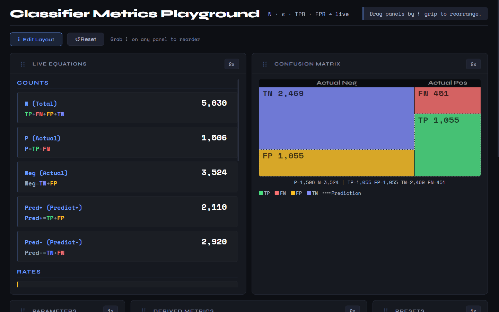

This differs from the current compact dashboard, whose data-group dragging edits model parameters and whose panel boxes are fixed. Discrete 1x/2x/3x/4x widths are not arbitrary drag-to-resize corners.

### Uploaded-row limits differ

The same deterministic CSV contained 1,500 alternating labels with positive scores 0.9 and negative scores 0.1. The importer’s own status and resulting model state were captured. A three-record JSON fixture was then uploaded too.

| Branch | CSV observed result | JSON result |
| --- | --- | --- |
| custom_data | Loaded 1000 rows from review-1500.csv. Move Threshold (below) to walk the ROC. | Loaded 3 rows from review-small.json. Move Threshold (below) to walk the ROC. |
| master | Loaded 1500 rows from review-1500.csv. Move Threshold (below) to walk the ROC. | Loaded 3 rows from review-small.json. Move Threshold (below) to walk the ROC. |
| mobile_view_rework | Loaded 1500 rows from review-1500.csv. Move Threshold (below) to walk the ROC. | Loaded 3 rows from review-small.json. Move Threshold (below) to walk the ROC. |
| refactor_big | Loaded 1000 rows from review-1500.csv. Move Threshold (below) to walk the ROC. | Loaded 3 rows from review-small.json. Move Threshold (below) to walk the ROC. |
| custom_data_2000 | Loaded 1500 rows from review-1500.csv. Move Threshold (below) to walk the ROC. | Loaded 3 rows from review-small.json. Move Threshold (below) to walk the ROC. |
| mosaic_bounds | Loaded 1000 rows from review-1500.csv. Move Threshold (below) to walk the ROC. | Loaded 3 rows from review-small.json. Move Threshold (below) to walk the ROC. |

The source/UI caps are 2,000 for custom_data_2000/master/mobile_view_rework and 1,000 for custom_data/mosaic_bounds/refactor_big. The browser directly tested 1,500 records, not the complete 2,000/2,001 boundary. Truncation to 1,000 is an observed capacity difference, not automatically a defect when the limit is advertised.

### Latest drag behavior differs from the local checkpoint

| Version | Before (separation / prevalence) | After horizontal start | After correcting gesture vertically |
| --- | --- | --- | --- |
| 1e973a5 | 60 / 10 | 63 / 10 | 63 / 10 |
| 4ad5b18 | 60 / 10 | 62 / 10 | 60 / 18 |

The later implementation resets the previous axis’s adjustment when switching axes. This was executed with a single held mouse gesture, not inferred only from a source diff.

### Bayes lesson controls were added in the visual branch

feature_simple_bayes_story shows the lesson with only the three main simulator inputs visible. feature_simple_bayes_story_overall_visual adds bayesThreshold, bayesSeparation and bayesPrevalence inside the Bayes tab. Both display live prior/evidence/posterior numbers and four learning sections. The newer lesson explains why the 1,000-person cohort cancels out of the Bayes rate formula.

### Mobile rework is a different navigation model

Matrix, Metrics, Curves and ROC tabs in mobile_view_rework each displayed the intended panel at 390×844. Advanced reveals import/model controls without returning to the long stacked layout.

| Panel | Observed | Evidence |
| --- | --- | --- |
| cmPanel | Visible after tap/click | [Screenshot](screenshots/1f35d26-mobile-cmPanel.png) |
| metricsPanel | Visible after tap/click | [Screenshot](screenshots/1f35d26-mobile-metricsPanel.png) |
| distPanel | Visible after tap/click | [Screenshot](screenshots/1f35d26-mobile-distPanel.png) |
| rocPanel | Visible after tap/click | [Screenshot](screenshots/1f35d26-mobile-rocPanel.png) |

### Names can be misleading

- simple and feature_simple_hover_metrics share the **entire same tip commit** (a0af2f9).
- old_Release, old_Release_Dark_Claude and old_movable have **byte-identical root HTML**, although their other files differ. I still opened each version.
- main and old_dev have **byte-identical root HTML**, but their nested /dev/ pages differ substantially.
- mosaic_bounds differs from custom_data_2000 by five 2,000→1,000 limit/label changes in index.html. The visible difference is the import/dot cap, not a new bounds-setting control.
- master is the remote default; main is an older dark-tile application. Neither name identifies the current teaching-focused line.

## Detailed review and screenshots

### featursimple_bayes_story_overall_visual_GemFixes

**Best current teaching base.** Family: Compact teaching simulator. Commit: `4ad5b18ff465358ac25b538f50dc2e068f7cb644`. Commit date: 2026-10-25T08:30:12+01:00.

**What it does:** Most complete compact CMatrixLab: five domains (Medical, Car braking, Spam, Fraud, Generic ML), Default/4-Up/Gaussians/ROC/PR/Bayes views, three matrix arrangements, linked score dots and matrix markers, group dragging, and separate Learn/Reference/Cheatsheet pages.

**What is different:** Latest checkpoint of the compact line. Defaults to medical prevalence 10%. Improves drag sensitivity, axis correction and the hand-shaped drag hint relative to Branch_1e973a51. It does not include real-data import or movable dashboard panels.

**Where it is useful:** Continue the learning-focused product here; address the existing detailed QA report before release.

**Caution:** The previous complete QA report records F1-edge, explanation, accessibility and responsive issues. Opening successfully here is not a clean release certification.

**Executed checks:** range ArrowRight, scenario, ROC view; metric pin and precision/balance teaching interaction (PASS), threshold line drag (PASS), all six graph modes + layout cycle (PASS).

**Layout:** initial document dimensions desktop 1440×900, phone 390×844; Fits initial view. These dimensions alone do not establish that every inner panel is visible.

[Local preview](http://localhost:8207/) · [Desktop full-size image](screenshots/4ad5b18-desktop.png) · [Phone full-size image](screenshots/4ad5b18-mobile.png)

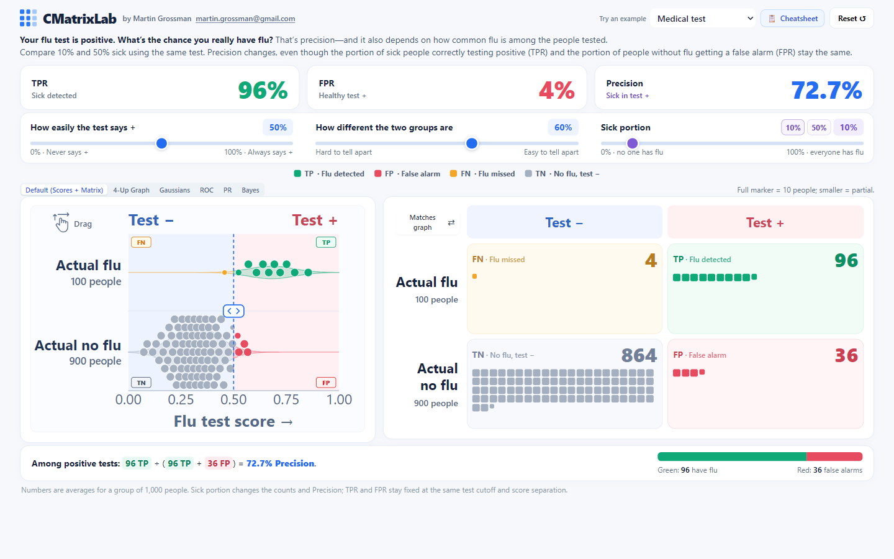

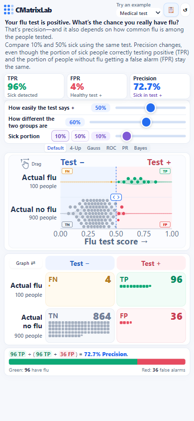

Additional pages opened in this branch:

| Path | Observed page | State | Desktop / phone evidence |
| --- | --- | --- | --- |
| cheatsheet.html | Metrics Cheatsheet · CMatrixLab | Rendered | [Desktop](screenshots/4ad5b18-cheatsheet_html-desktop.png) · [Phone](screenshots/4ad5b18-cheatsheet_html-mobile.png) |
| learn.html | CMatrixLab · Learn: From a Result to a Probability | Rendered | [Desktop](screenshots/4ad5b18-learn_html-desktop.png) · [Phone](screenshots/4ad5b18-learn_html-mobile.png) |
| reference.html | Metrics Reference · CMatrixLab | Rendered | [Desktop](screenshots/4ad5b18-reference_html-desktop.png) · [Phone](screenshots/4ad5b18-reference_html-mobile.png) |

### Branch_1e973a51

**Earlier checkpoint of current app.** Family: Compact teaching simulator. Commit: `1e973a517d24b66e04d895c5f21427ba813c01ce`. Commit date: 2026-10-24T18:27:02+02:00.

**What it does:** Same broad five-domain/six-view experience and separate educational/reference pages as the latest compact version. Group dragging adjusts separation horizontally or positive proportion vertically.

**What is different:** Earlier drag implementation locks the initial axis. A gesture that began horizontally remained at separation 63%, prevalence 10%; the same gesture in the latest branch reset separation to 60% and changed prevalence to 18%.

**Where it is useful:** Useful comparison point for the drag behavior; not a separate product direction.

**Caution:** Local-only branch name. Latest compact branch is its verified descendant.

**Executed checks:** range ArrowRight, scenario, ROC view; metric pin and precision/balance teaching interaction (PASS), threshold line drag (PASS), all six graph modes + layout cycle (PASS).

**Layout:** initial document dimensions desktop 1440×900, phone 390×844; Fits initial view. These dimensions alone do not establish that every inner panel is visible.

[Local preview](http://localhost:8201/) · [Desktop full-size image](screenshots/1e973a5-desktop.png) · [Phone full-size image](screenshots/1e973a5-mobile.png)

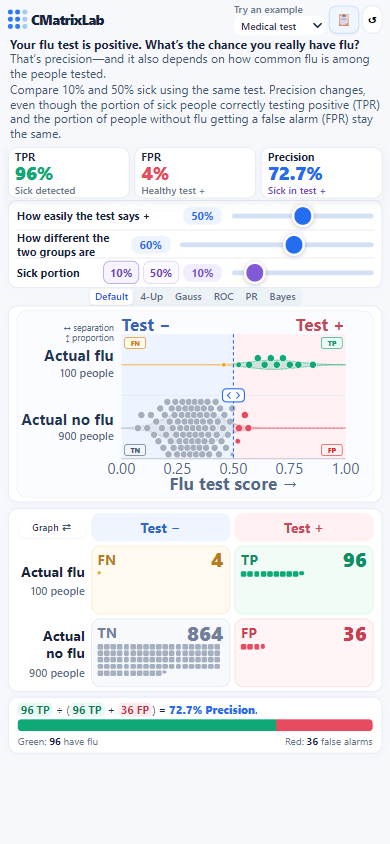

Additional pages opened in this branch:

| Path | Observed page | State | Desktop / phone evidence |
| --- | --- | --- | --- |
| cheatsheet.html | Metrics Cheatsheet · CMatrixLab | Rendered | [Desktop](screenshots/1e973a5-cheatsheet_html-desktop.png) · [Phone](screenshots/1e973a5-cheatsheet_html-mobile.png) |
| learn.html | CMatrixLab · Learn: From a Result to a Probability | Rendered | [Desktop](screenshots/1e973a5-learn_html-desktop.png) · [Phone](screenshots/1e973a5-learn_html-mobile.png) |
| reference.html | Metrics Reference · CMatrixLab | Rendered | [Desktop](screenshots/1e973a5-reference_html-desktop.png) · [Phone](screenshots/1e973a5-reference_html-mobile.png) |

### feature_simple_bayes_story_overall_visual

**Expanded Bayes lesson and visual refinement.** Family: Compact teaching simulator. Commit: `b37faceb99796dd73f0858c725a185c80d792fe5`. Commit date: 2026-10-21T08:19:02+02:00.

**What it does:** Keeps the compact simulator plus inline four-tab learning layer, with clearer natural-frequency Bayes steps, conditional-probability explanations and live equations.

**What is different:** Compared with feature_simple_bayes_story, the Bayes tab adds its own synchronized threshold, separation and prevalence sliders. Browser inspection found six visible inputs there (three main plus three Bayes) versus three in the earlier branch.

**Where it is useful:** Useful source for inline educational controls and Bayes explanation layout.

**Caution:** Still the two-domain/one-main-graph generation, not the modern five-domain/six-view dashboard.

**Executed checks:** range ArrowRight, mode toggle, Learn more; metric pin and precision/balance teaching interaction (PASS), threshold line drag (PASS), four learning tabs (PASS).

**Layout:** initial document dimensions desktop 1440×900, phone 390×844; Fits initial view. These dimensions alone do not establish that every inner panel is visible.

[Local preview](http://localhost:8205/) · [Desktop full-size image](screenshots/b37face-desktop.png) · [Phone full-size image](screenshots/b37face-mobile.png)

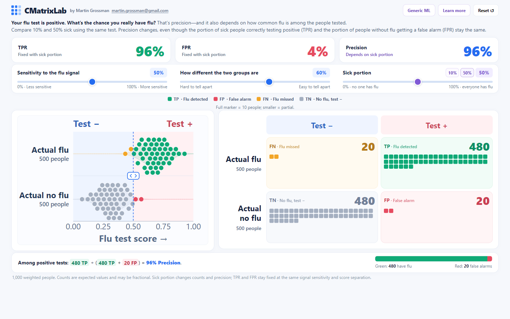

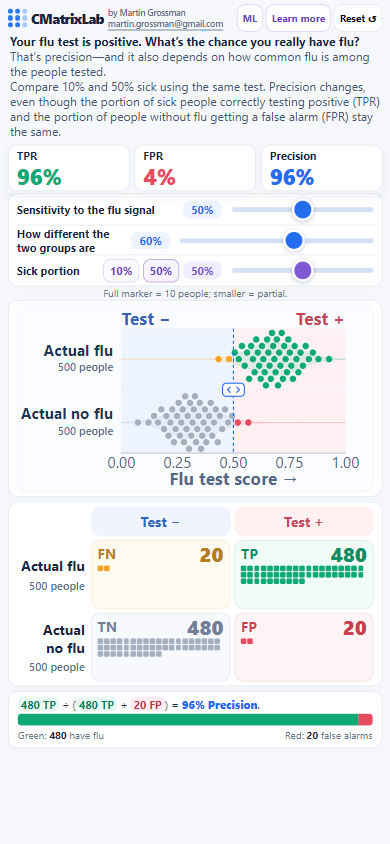

### feature_simple_bayes_story

**First integrated learning/story version.** Family: Compact teaching simulator. Commit: `7db2c1bd58d9aab29831f012ecccd9dfa69e729a`. Commit date: 2026-10-20T15:57:01+02:00.

**What it does:** Builds on the simple highlight simulator and adds Learn more with four sections: Basics, Formulas, Bayes and Trade-offs. Learning content and live model remain in the same page.

**What is different:** The Bayes tab displays prior/evidence/posterior counts and 10%/50% comparison cards. It does not yet add duplicate sliders inside the Bayes section.

**Where it is useful:** Reference for the inline learning flow and early explanation copy.

**Caution:** No multi-domain scenario dropdown or dashboard graph-view strip.

**Executed checks:** range ArrowRight, mode toggle, Learn more; metric pin and precision/balance teaching interaction (PASS), threshold line drag (PASS), four learning tabs (PASS).

**Layout:** initial document dimensions desktop 1440×900, phone 390×844; Fits initial view. These dimensions alone do not establish that every inner panel is visible.

[Local preview](http://localhost:8204/) · [Desktop full-size image](screenshots/7db2c1b-desktop.png) · [Phone full-size image](screenshots/7db2c1b-mobile.png)

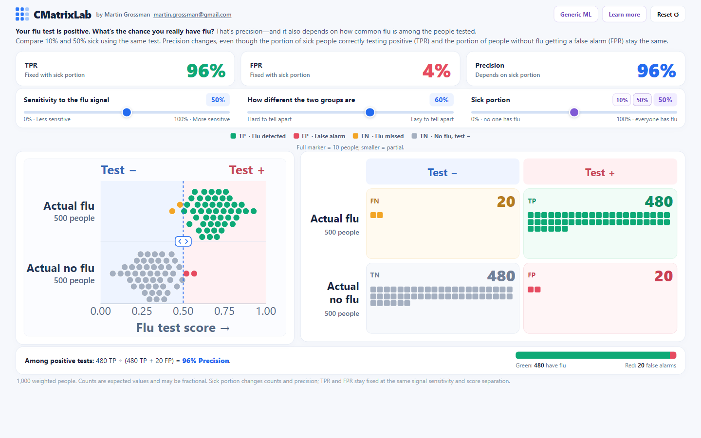

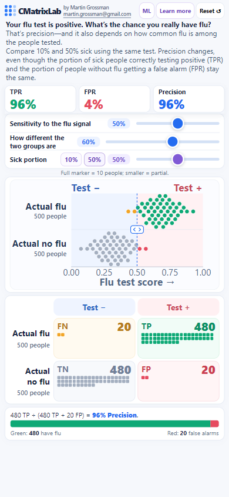

### feature_simple_hover_metrics / simple

**Minimal linked-highlight demo.** Family: Compact teaching simulator. Commit: `a0af2f9ec6d4b75eb1b59a5904619a4f39f6bdfc`. Commit date: 2026-10-20T07:31:42+02:00.

**What it does:** Flu/Generic ML simulator with threshold, separation, positive-share controls, matching dot/square markers and three metric buttons (TPR, FPR, Precision). Hover/click highlighting and pin behavior are present.

**What is different:** Adds interactive metric highlighting to the earlier threshold-dragging version. No scenario dropdown, six-view graph tabs or Learn panel. Medical starts at 50% positives.

**Where it is useful:** Small, focused base-rate and linked-highlight demonstration.

**Caution:** simple and feature_simple_hover_metrics are exactly the same commit, not two distinct implementations.

**Executed checks:** range ArrowRight, mode toggle; metric pin and precision/balance teaching interaction (PASS), threshold line drag (PASS).

**Layout:** initial document dimensions desktop 1440×900, phone 390×844; Fits initial view. These dimensions alone do not establish that every inner panel is visible.

[Local preview](http://localhost:8206/) · [Desktop full-size image](screenshots/a0af2f9-desktop.png) · [Phone full-size image](screenshots/a0af2f9-mobile.png)

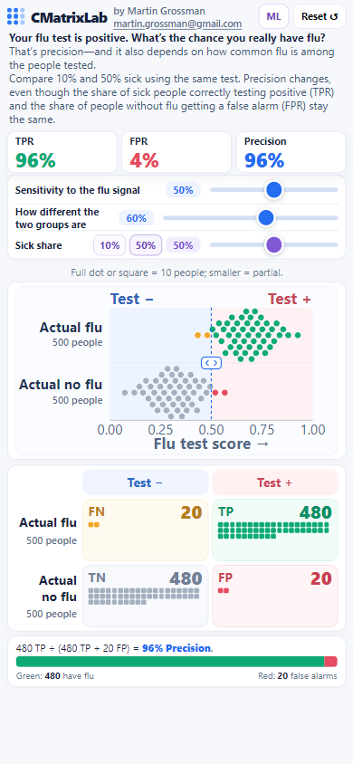

### feature_simple_dragging_thr

**Threshold-drag milestone.** Family: Compact teaching simulator. Commit: `a9c55450dbcf34e4c2b81b2c2f762ab2f82ed298`. Commit date: 2026-10-20T07:18:08+02:00.

**What it does:** Minimal flu/Generic ML simulator with the blue draggable threshold line, two linked displays, three headline rates, 10%/50% share shortcuts and Reset.

**What is different:** Threshold dragging works in the browser. The later metric-card pinning/hover feature is absent.

**Where it is useful:** Reference for the initial graph-handle interaction.

**Caution:** Superseded by the hover/story/current compact line; no real-data upload or movable panels.

**Executed checks:** range ArrowRight, mode toggle; threshold line drag (PASS).

**Layout:** initial document dimensions desktop 1440×900, phone 390×844; Fits initial view. These dimensions alone do not establish that every inner panel is visible.

[Local preview](http://localhost:8213/) · [Desktop full-size image](screenshots/a9c5545-desktop.png) · [Phone full-size image](screenshots/a9c5545-mobile.png)

### simple_cld

**Earliest simple entry point.** Family: Compact teaching simulator. Commit: `c64062256bd4a3d8b62b2c4d9df98814d48d1948`. Commit date: 2026-10-19T08:58:09+02:00.

**What it does:** The homepage redirects to cmatrixlab_minimal_readable.html. It presents a basic flu/Generic ML explanation, sliders, score dots, confusion matrix and precision strip.

**What is different:** This is the initial minimal readable version. The inspected page does not expose the later threshold-drag handle or interactive metric-card buttons; use the sliders. Defaults to 50% sick share.

**Where it is useful:** Historical baseline for how the compact teaching experience began.

**Caution:** The real page is the redirect target, not the tiny root index.html.

**Executed checks:** range ArrowRight, mode toggle; baseline controls and page inspection.

**Layout:** initial document dimensions desktop 1440×900, phone 390×844; Fits initial view. These dimensions alone do not establish that every inner panel is visible.

[Local preview](http://localhost:8211/) · [Desktop full-size image](screenshots/c640622-desktop.png) · [Phone full-size image](screenshots/c640622-mobile.png)

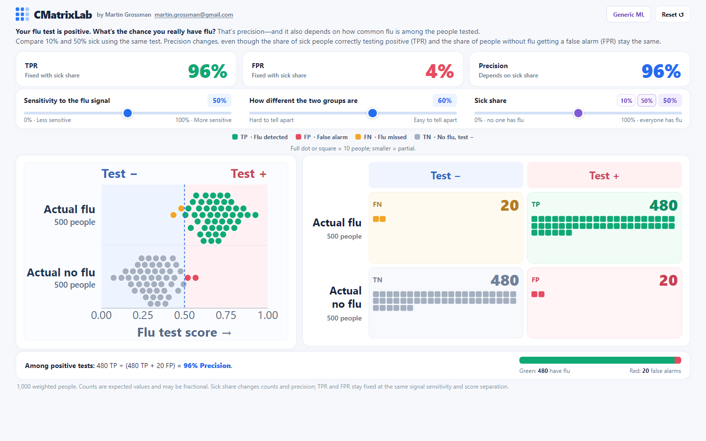

Additional pages opened in this branch:

| Path | Observed page | State | Desktop / phone evidence |
| --- | --- | --- | --- |
| cmatrixlab_minimal_readable.html | CMatrixLab — Simple | Rendered | [Desktop](screenshots/c640622-cmatrixlab_minimal_readable_html-desktop.png) · [Phone](screenshots/c640622-cmatrixlab_minimal_readable_html-mobile.png) |

### mobile_view_rework

**Best advanced mobile interaction model.** Family: Advanced ROC / data dashboard. Commit: `1f35d2634c6c1bc4f1c589e508a38aae92c0092c`. Commit date: 2026-05-11T08:19:08+02:00.

**What it does:** Keeps the advanced desktop/data dashboard but reworks phones into pinned manual controls and Matrix / Metrics / Curves / ROC tabs. Advanced tools reveal data/model options.

**What is different:** At 390×844 the default document fits the viewport and each of the four mobile tabs activated its intended panel. Advanced reveals the Custom data entry and Manual/Gaussian switch. Both 1,500-row CSV and three-row JSON imports worked.

**Where it is useful:** Preferred advanced branch for phone-oriented data exploration; good source for a tabbed mobile layout.

**Caution:** The manual ROC point can sit off the Gaussian ROC curve by design; the UI explicitly warns about the two modes. Phone targets and all numerical boundaries were not exhaustively audited here.

**Executed checks:** range ArrowRight, file import discovered; light/dark theme (PASS), btn_cm (PASS), btn_mosaic (PASS), btn_metrics_bar (PASS), btn_metrics_formulas (PASS), btn_metrics_theory (PASS), btn_dist_topview (PASS), btn_dist_curves (PASS), direct/linked score mode (PASS), CSV import 1500 rows and actual cap (PASS), JSON import three rows (PASS).

**Layout:** initial document dimensions desktop 1440×900, phone 390×844; Fits initial view. These dimensions alone do not establish that every inner panel is visible.

[Local preview](http://localhost:8209/) · [Desktop full-size image](screenshots/1f35d26-desktop.png) · [Phone full-size image](screenshots/1f35d26-mobile.png)

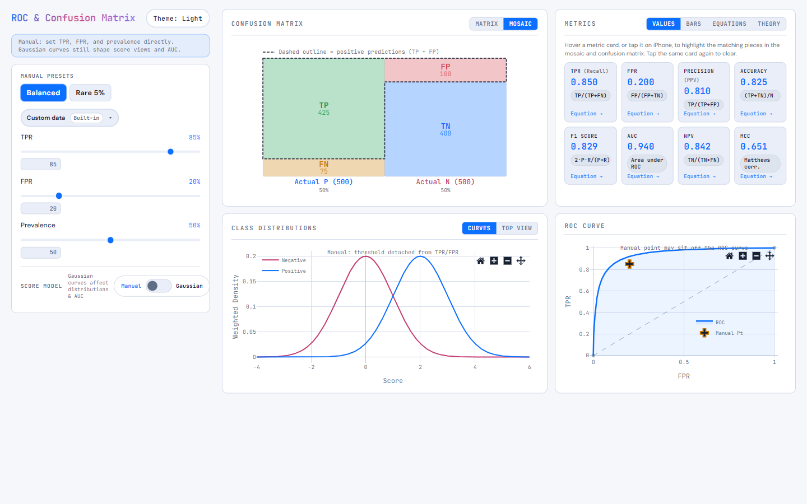

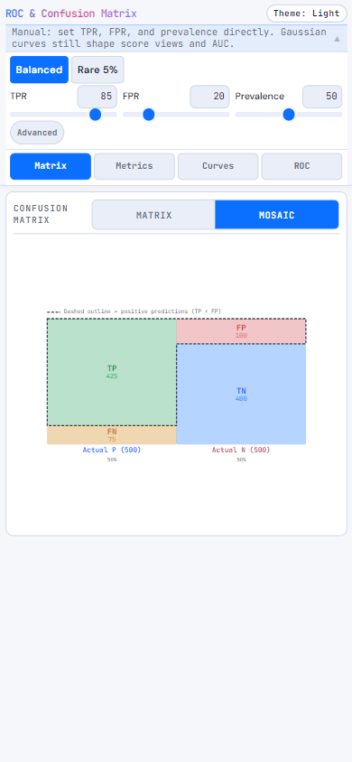

Additional pages opened in this branch:

| Path | Observed page | State | Desktop / phone evidence |
| --- | --- | --- | --- |
| archive/design_0/index.html | Classifier Metrics Playground | Rendered | [Desktop](screenshots/1f35d26-archive_design_0_index_html-desktop.png) · [Phone](screenshots/1f35d26-archive_design_0_index_html-mobile.png) |
| archive/dev_2/index.html | ROC & Confusion Matrix Playground | Rendered | [Desktop](screenshots/1f35d26-archive_dev_2_index_html-desktop.png) · [Phone](screenshots/1f35d26-archive_dev_2_index_html-mobile.png) |

### master

**Default remote branch; broad data feature set.** Family: Advanced ROC / data dashboard. Commit: `4d301a2065e1acc89d9d67cbc7d58cd33be78019`. Commit date: 2026-04-14T07:21:43+02:00.

**What it does:** The remote default is master. It is the advanced Plotly dashboard with themes, real CSV/JSON input, manual/linked score modes, matrix/mosaic, values/bars/equations/theory and distribution/ROC tools.

**What is different:** Compared with refactor_big, prototypes move under archive/, the index returns to a large standalone implementation and metrics_core.js/test scaffolding disappear. The UI allows 2,000 upload rows; 1,500 were imported in the browser.

**Where it is useful:** Useful broad advanced desktop baseline; it is not the compact simulator currently checked out.

**Caution:** 390px homepage requires long scrolling. Default remote branch status does not mean it is the newest teaching-focused implementation.

**Executed checks:** range ArrowRight, file import discovered; light/dark theme (PASS), btn_cm (PASS), btn_mosaic (PASS), btn_metrics_bar (PASS), btn_metrics_formulas (PASS), btn_metrics_theory (PASS), btn_dist_topview (PASS), btn_dist_curves (PASS), direct/linked score mode (PASS), CSV import 1500 rows and actual cap (PASS), JSON import three rows (PASS).

**Layout:** initial document dimensions desktop 1440×900, phone 386×2177; Page scroll. These dimensions alone do not establish that every inner panel is visible.

[Local preview](http://localhost:8208/) · [Desktop full-size image](screenshots/4d301a2-desktop.png) · [Phone full-size image](screenshots/4d301a2-mobile.png)

Additional pages opened in this branch:

| Path | Observed page | State | Desktop / phone evidence |
| --- | --- | --- | --- |
| archive/design_0/index.html | Classifier Metrics Playground | Rendered | [Desktop](screenshots/4d301a2-archive_design_0_index_html-desktop.png) · [Phone](screenshots/4d301a2-archive_design_0_index_html-mobile.png) |
| archive/dev_2/index.html | ROC & Confusion Matrix Playground | Rendered | [Desktop](screenshots/4d301a2-archive_dev_2_index_html-desktop.png) · [Phone](screenshots/4d301a2-archive_dev_2_index_html-mobile.png) |

### refactor_big

**Math-core refactor and test foundation.** Family: Advanced ROC / data dashboard. Commit: `fea3edaa6f0dbdc5d8a8c4d3229ba9d7e8568926`. Commit date: 2026-04-12T07:52:56+02:00.

**What it does:** Retains the advanced dashboard and real-data importer, but extracts numerical/import/ROC functions into metrics_core.js and includes unit and visual-test scaffolding.

**What is different:** The browser loaded metrics_core.js successfully; matrix/mosaic, all metric views, model-mode switch and CSV/JSON imports worked. Its CSV cap remains 1,000.

**Where it is useful:** Best branch to study for separating the advanced app’s math from rendering and testing it independently.

**Caution:** Not the newest UI. The full historical test suite was not run during this comparison campaign; presence of tests is not a claim that every test passed.

**Executed checks:** range ArrowRight, file import discovered; light/dark theme (PASS), btn_cm (PASS), btn_mosaic (PASS), btn_metrics_bar (PASS), btn_metrics_formulas (PASS), btn_metrics_theory (PASS), btn_dist_topview (PASS), btn_dist_curves (PASS), direct/linked score mode (PASS), CSV import 1500 rows and actual cap (PASS), JSON import three rows (PASS).

**Layout:** initial document dimensions desktop 1440×900, phone 386×2177; Page scroll. These dimensions alone do not establish that every inner panel is visible.

[Local preview](http://localhost:8210/) · [Desktop full-size image](screenshots/fea3eda-desktop.png) · [Phone full-size image](screenshots/fea3eda-mobile.png)

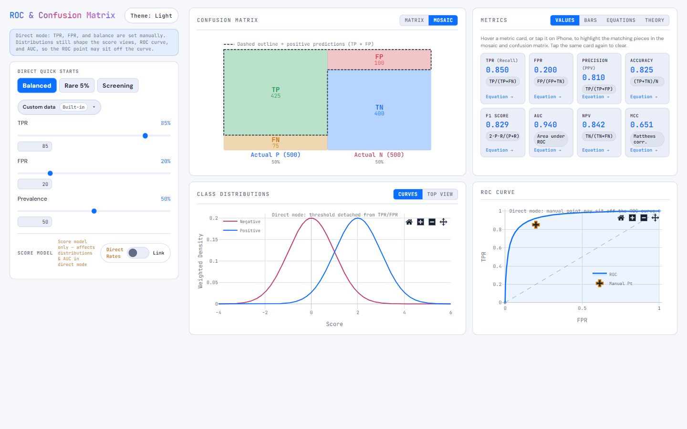

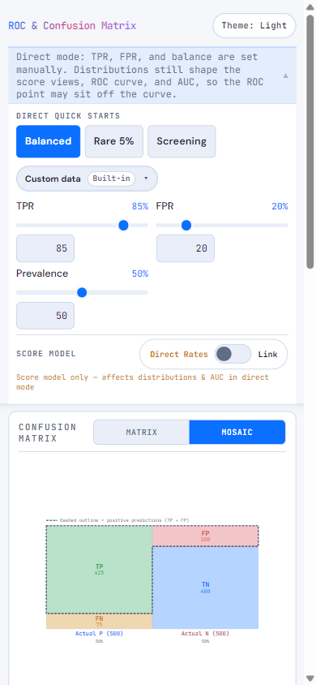

Additional pages opened in this branch:

| Path | Observed page | State | Desktop / phone evidence |
| --- | --- | --- | --- |
| design_0/index.html | Classifier Metrics Playground | Rendered | [Desktop](screenshots/fea3eda-design_0_index_html-desktop.png) · [Phone](screenshots/fea3eda-design_0_index_html-mobile.png) |
| dev_2/index.html | ROC & Confusion Matrix Playground | Rendered | [Desktop](screenshots/fea3eda-dev_2_index_html-desktop.png) · [Phone](screenshots/fea3eda-dev_2_index_html-mobile.png) |

### custom_data_2000

**2,000-row import capacity.** Family: Advanced ROC / data dashboard. Commit: `8facffd67569ada6dda6123520d8c3484be8818c`. Commit date: 2026-04-07T15:39:15+02:00.

**What it does:** Real-data dashboard with the same major manual/Gaussian, matrix/mosaic, metric/theory, ROC and distribution tools as the custom-data line.

**What is different:** Increases CSV/JSON capacity to 2,000 rows in source/UI. The browser test successfully imported all 1,500 supplied rows.

**Where it is useful:** Useful source for the larger import cap and uploaded-score workflow.

**Caution:** Despite the name, the built-in simulator still starts at N=1,000; the changed limit concerns uploaded records. Phone layout remains long.

**Executed checks:** range ArrowRight, file import discovered; light/dark theme (PASS), btn_cm (PASS), btn_mosaic (PASS), btn_metrics_bar (PASS), btn_metrics_formulas (PASS), btn_metrics_theory (PASS), btn_dist_topview (PASS), btn_dist_curves (PASS), direct/linked score mode (PASS), CSV import 1500 rows and actual cap (PASS), JSON import three rows (PASS).

**Layout:** initial document dimensions desktop 1440×900, phone 386×2177; Page scroll. These dimensions alone do not establish that every inner panel is visible.

[Local preview](http://localhost:8212/) · [Desktop full-size image](screenshots/8facffd-desktop.png) · [Phone full-size image](screenshots/8facffd-mobile.png)

Additional pages opened in this branch:

| Path | Observed page | State | Desktop / phone evidence |
| --- | --- | --- | --- |
| design_0/index.html | Classifier Metrics Playground | Rendered | [Desktop](screenshots/8facffd-design_0_index_html-desktop.png) · [Phone](screenshots/8facffd-design_0_index_html-mobile.png) |
| dev_2/index.html | ROC & Confusion Matrix Playground | Rendered | [Desktop](screenshots/8facffd-dev_2_index_html-desktop.png) · [Phone](screenshots/8facffd-dev_2_index_html-mobile.png) |

### mosaic_bounds

**Similar UI with reduced import cap.** Family: Advanced ROC / data dashboard. Commit: `e54de2254ef26892dc38aa02ea0f9ef6e6768428`. Commit date: 2026-04-06T22:11:58+02:00.

**What it does:** Visually close to custom_data_2000, with the same direct-rate/Gaussian switches, matrix/mosaic and educational metric panels.

**What is different:** The actual diff against custom_data_2000 changes five limits/labels from 2,000 to 1,000, including maximum dots; it does not introduce a distinct new homepage bounds control. Browser import loaded 1,000 of 1,500 records.

**Where it is useful:** Keep as a historical comparison for the 1,000-row/dot-limit behavior.

**Caution:** Do not infer the feature from the branch name: the measurable difference is the lower cap.

**Executed checks:** range ArrowRight, file import discovered; light/dark theme (PASS), btn_cm (PASS), btn_mosaic (PASS), btn_metrics_bar (PASS), btn_metrics_formulas (PASS), btn_metrics_theory (PASS), btn_dist_topview (PASS), btn_dist_curves (PASS), direct/linked score mode (PASS), CSV import 1500 rows and actual cap (PASS), JSON import three rows (PASS).

**Layout:** initial document dimensions desktop 1440×900, phone 386×2177; Page scroll. These dimensions alone do not establish that every inner panel is visible.

[Local preview](http://localhost:8215/) · [Desktop full-size image](screenshots/e54de22-desktop.png) · [Phone full-size image](screenshots/e54de22-mobile.png)

Additional pages opened in this branch:

| Path | Observed page | State | Desktop / phone evidence |
| --- | --- | --- | --- |
| design_0/index.html | Classifier Metrics Playground | Rendered | [Desktop](screenshots/e54de22-design_0_index_html-desktop.png) · [Phone](screenshots/e54de22-design_0_index_html-mobile.png) |
| dev_2/index.html | ROC & Confusion Matrix Playground | Rendered | [Desktop](screenshots/e54de22-dev_2_index_html-desktop.png) · [Phone](screenshots/e54de22-dev_2_index_html-mobile.png) |

### custom_data

**Initial real-data import milestone.** Family: Advanced ROC / data dashboard. Commit: `62826067267d98d3b6b7ebfb95b4ce4f2574f59c`. Commit date: 2026-04-06T19:44:59+02:00.

**What it does:** Dense light/colorblind/dark-capable dashboard with direct TPR/FPR/prevalence controls, linked Gaussian-score mode, matrix/mosaic, metric values/bars/equations/theory, distribution curves/top view, and ROC.

**What is different:** Adds CSV/JSON upload over the mosaic-focused predecessor. The 1,500-row CSV test loaded only 1,000 rows; a three-row JSON file loaded successfully.

**Where it is useful:** Reference for the first importer and empirical score/ROC workflow.

**Caution:** At 390px the dashboard becomes a long scrolling document (~2,177px measured), unlike the later mobile tabbed rework.

**Executed checks:** range ArrowRight, file import discovered; light/dark theme (PASS), btn_cm (PASS), btn_mosaic (PASS), btn_metrics_bar (PASS), btn_metrics_formulas (PASS), btn_metrics_theory (PASS), btn_dist_topview (PASS), btn_dist_curves (PASS), direct/linked score mode (PASS), CSV import 1500 rows and actual cap (PASS), JSON import three rows (PASS).

**Layout:** initial document dimensions desktop 1440×900, phone 386×2177; Page scroll. These dimensions alone do not establish that every inner panel is visible.

[Local preview](http://localhost:8202/) · [Desktop full-size image](screenshots/6282606-desktop.png) · [Phone full-size image](screenshots/6282606-mobile.png)

Additional pages opened in this branch:

| Path | Observed page | State | Desktop / phone evidence |
| --- | --- | --- | --- |
| design_0/index.html | Classifier Metrics Playground | Rendered | [Desktop](screenshots/6282606-design_0_index_html-desktop.png) · [Phone](screenshots/6282606-design_0_index_html-mobile.png) |
| dev_2/index.html | ROC & Confusion Matrix Playground | Rendered | [Desktop](screenshots/6282606-dev_2_index_html-desktop.png) · [Phone](screenshots/6282606-dev_2_index_html-mobile.png) |

### feature_mosaic_improvments

**Mosaic readability milestone.** Family: Advanced ROC / data dashboard. Commit: `40918b193385ba1f687265158ed20b4a83d6d6e5`. Commit date: 2026-04-06T12:10:02+02:00.

**What it does:** Advanced direct-rate/Gaussian dashboard with matrix/mosaic, linked metric highlights, equations and theory panels, class-distribution views and ROC.

**What is different:** Focuses on mosaic presentation and larger labels. It has no custom-data file input. Its default manual rates are 90% TPR / 10% FPR rather than the later imported-data line’s 85% / 20%.

**Where it is useful:** Reference for mosaic readability and metric-to-outcome highlighting.

**Caution:** Older long mobile layout; later branches carry broader data and model features.

**Executed checks:** range ArrowRight; light/dark theme (PASS), btn_cm (PASS), btn_mosaic (PASS), btn_metrics_bar (PASS), btn_metrics_formulas (PASS), btn_metrics_theory (PASS), btn_dist_topview (PASS), btn_dist_curves (PASS), direct/linked score mode (PASS).

**Layout:** initial document dimensions desktop 1440×900, phone 386×2093; Page scroll. These dimensions alone do not establish that every inner panel is visible.

[Local preview](http://localhost:8203/) · [Desktop full-size image](screenshots/40918b1-desktop.png) · [Phone full-size image](screenshots/40918b1-mobile.png)

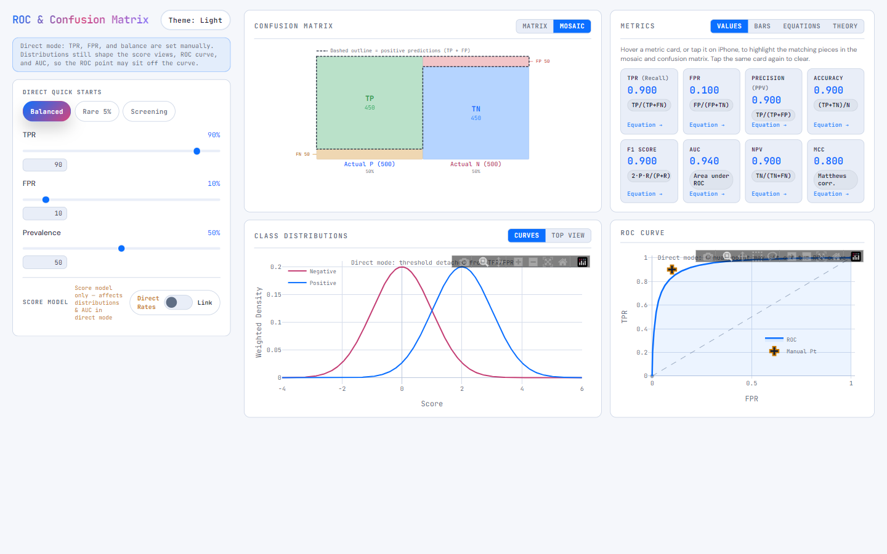

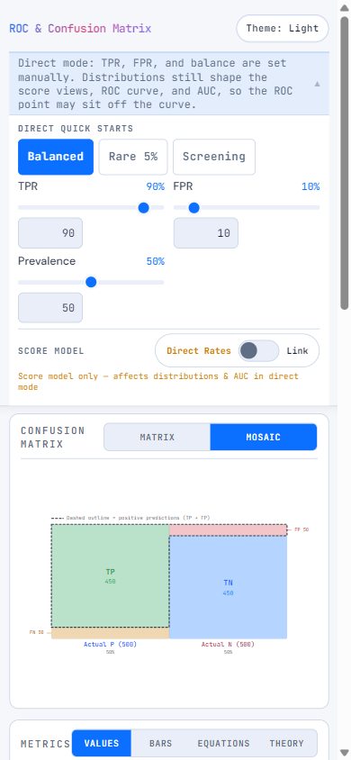

Additional pages opened in this branch:

| Path | Observed page | State | Desktop / phone evidence |
| --- | --- | --- | --- |
| design_0/index.html | Classifier Metrics Playground | Rendered | [Desktop](screenshots/40918b1-design_0_index_html-desktop.png) · [Phone](screenshots/40918b1-design_0_index_html-mobile.png) |
| dev_2/index.html | ROC & Confusion Matrix Playground | Rendered | [Desktop](screenshots/40918b1-dev_2_index_html-desktop.png) · [Phone](screenshots/40918b1-dev_2_index_html-mobile.png) |

### old_claude_improvments

**Early direct / Gaussian dashboard.** Family: Advanced ROC / data dashboard. Commit: `04bef33d734ca33eda00e7fe8d9f1b9693e7f356`. Commit date: 2026-04-05T16:32:01+02:00.

**What it does:** Shows explicit direct-vs-linked mode messaging, Gaussian means/spreads, dataset size and threshold, confusion-matrix/mosaic views, metrics and theory, and ROC/distribution charts.

**What is different:** Earlier generation with 90% TPR / 10% FPR defaults, more controls visible at once and fewer separated metric presentation buttons than later custom-data branches.

**Where it is useful:** Historical comparison for the transition from direct-rate tiles to Gaussian-score modeling.

**Caution:** Both desktop and phone pages scroll; no CSV/JSON importer on this root page.

**Executed checks:** range ArrowRight; light/dark theme (PASS), btn_cm (PASS), btn_mosaic (PASS), btn_metrics_bar (PASS), btn_metrics_eqs (PASS), btn_dist_topview (PASS), btn_dist_curves (PASS), direct/linked score mode (PASS).

**Layout:** initial document dimensions desktop 1425×1222, phone 386×1937; Page scroll. These dimensions alone do not establish that every inner panel is visible.

[Local preview](http://localhost:8218/) · [Desktop full-size image](screenshots/04bef33-desktop.png) · [Phone full-size image](screenshots/04bef33-mobile.png)

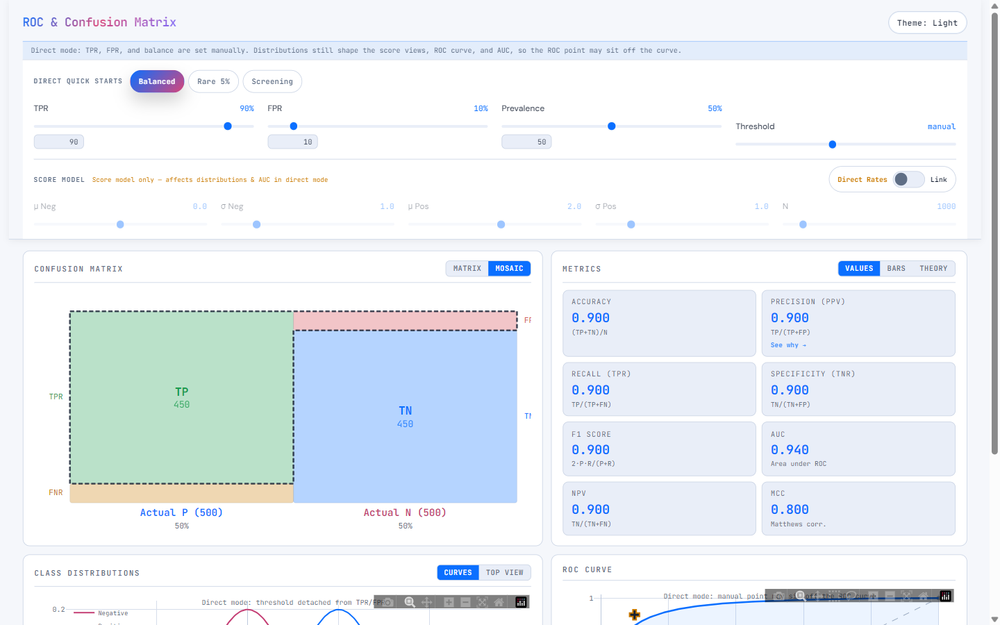

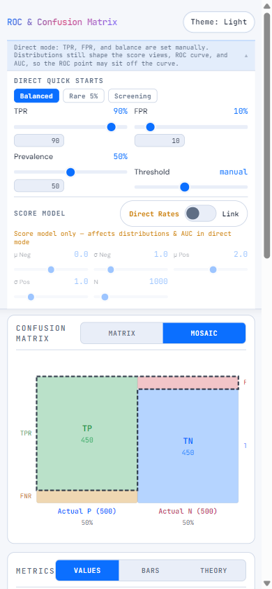

Additional pages opened in this branch:

| Path | Observed page | State | Desktop / phone evidence |
| --- | --- | --- | --- |
| design_0/index.html | Classifier Metrics Playground | Rendered | [Desktop](screenshots/04bef33-design_0_index_html-desktop.png) · [Phone](screenshots/04bef33-design_0_index_html-mobile.png) |
| dev_2/index.html | ROC & Confusion Matrix Playground | Rendered | [Desktop](screenshots/04bef33-dev_2_index_html-desktop.png) · [Phone](screenshots/04bef33-dev_2_index_html-mobile.png) |

### old_from_scratch

**Guided Gaussian-model prototype.** Family: Advanced ROC / data dashboard. Commit: `ffb6fc519d997170ab7757bb6ba2eba780b288b5`. Commit date: 2026-04-05T12:20:51+02:00.

**What it does:** A different advanced workflow: Step 1 shapes the two class distributions; Step 2 chooses the operating point; Step 3 sets N and prevalence. Direct/linked modes connect distributions, threshold and rates.

**What is different:** Includes collapsible instructional sections, weighted Gaussian distributions, ROC, matrix/mosaic and metric views. Phone layout adds a tune/inspect/compare summary and Controls / Outcomes / Metrics / Distributions navigation. Defaults to linked mode.

**Where it is useful:** Good reference for the clearest “shape → threshold → population” interaction sequence.

**Caution:** Long desktop/mobile document (about 1,034 / 2,768px in the initial check). No real-data file input was exposed on the root page.

**Executed checks:** range ArrowRight; light/dark theme (PASS), btn_cm (PASS), btn_mosaic (PASS), btn_metrics_bar (PASS), btn_metrics_eqs (PASS), btn_dist_topview (PASS), btn_dist_curves (PASS), direct/linked score mode (PASS).

**Layout:** initial document dimensions desktop 1425×1034, phone 375×2768; Page scroll. These dimensions alone do not establish that every inner panel is visible.

[Local preview](http://localhost:8221/) · [Desktop full-size image](screenshots/ffb6fc5-desktop.png) · [Phone full-size image](screenshots/ffb6fc5-mobile.png)

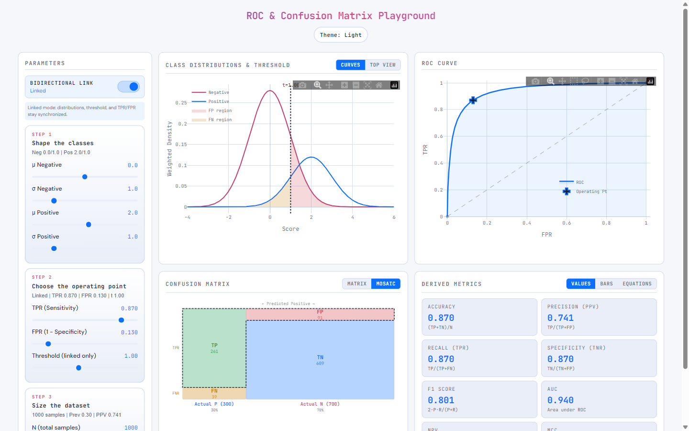

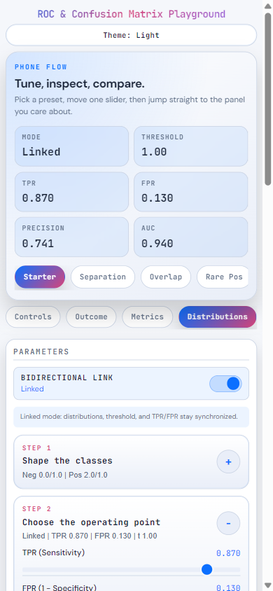

Additional pages opened in this branch:

| Path | Observed page | State | Desktop / phone evidence |
| --- | --- | --- | --- |
| design_0/index.html | Classifier Metrics Playground | Rendered | [Desktop](screenshots/ffb6fc5-design_0_index_html-desktop.png) · [Phone](screenshots/ffb6fc5-design_0_index_html-mobile.png) |
| dev_2/index.html | ROC & Confusion Matrix Playground | Rendered | [Desktop](screenshots/ffb6fc5-dev_2_index_html-desktop.png) · [Phone](screenshots/ffb6fc5-dev_2_index_html-mobile.png) |

### main

**Movable panels with widths on every tile.** Family: Legacy movable dark dashboard. Commit: `3c2e2765dcb2f877035f1a57c61090aae04c7bb9`. Commit date: 2026-03-29T08:15:01+02:00.

**What it does:** Dark manual-rate playground with N/prevalence/TPR/FPR, live equations, matrix, derived metrics, preset buttons, counts/rates charts, ROC/likelihood-ratio and PR panels.

**What is different:** Panel drag reorder and per-panel width buttons (1x→2x etc.) work, with order/sizes surviving refresh. Its root homepage is byte-identical to old_dev.

**Where it is useful:** Best existing source if the requirement is movable dashboard tiles with per-panel width changes.

**Caution:** The root uses internal scrolling on phones; “no document overflow” does not mean every panel fits. /dev/index.html is only a placeholder with a missing stylesheet (404).

**Executed checks:** range ArrowRight; panel reorder + width change + refresh persistence (PASS).

**Layout:** initial document dimensions desktop 1440×900, phone 390×844; Body/internal scroll. These dimensions alone do not establish that every inner panel is visible.

[Local preview](http://localhost:8214/) · [Desktop full-size image](screenshots/3c2e276-desktop.png) · [Phone full-size image](screenshots/3c2e276-mobile.png)

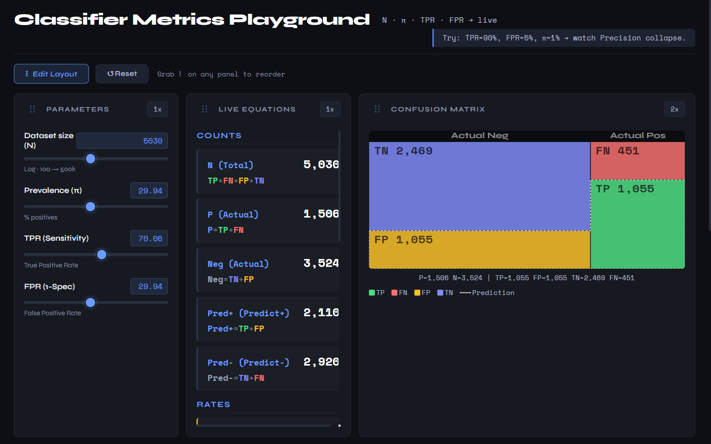

Additional pages opened in this branch:

| Path | Observed page | State | Desktop / phone evidence |
| --- | --- | --- | --- |
| dev/index.html | Metrics Dashboard placeholder | Issue: http://localhost:8214/dev/css/styles.css: net::ERR_ABORTED | [Desktop](screenshots/3c2e276-dev_index_html-desktop.png) · [Phone](screenshots/3c2e276-dev_index_html-mobile.png) |

### old_dev

**Same root as main; working nested development app.** Family: Legacy movable dark dashboard. Commit: `7d5385160a4b7dd8b2547c42b000f82199985822`. Commit date: 2026-03-31T06:57:59+02:00.

**What it does:** Same dark movable, resizable-by-width-button dashboard at the root as main. Panel reorder, width change and refresh persistence all worked.

**What is different:** Changes are in dev/index.html, dev/index.css, dev/js/app.js and styles/mosaic.css. Unlike main/dev’s heading-only placeholder, /dev/index.html is a complete working dashboard.

**Where it is useful:** Reference for the modular nested development experiment and movable-tile behavior.

**Caution:** Nested development screenshot shows dense panels, scrolling and clipped/overflowing inner text; it needs layout work before reuse.

**Executed checks:** range ArrowRight; panel reorder + width change + refresh persistence (PASS).

**Layout:** initial document dimensions desktop 1440×900, phone 390×844; Body/internal scroll. These dimensions alone do not establish that every inner panel is visible.

[Local preview](http://localhost:8220/) · [Desktop full-size image](screenshots/7d53851-desktop.png) · [Phone full-size image](screenshots/7d53851-mobile.png)

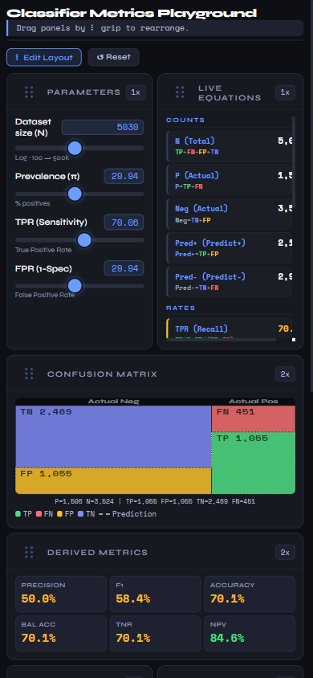

Additional pages opened in this branch:

| Path | Observed page | State | Desktop / phone evidence |
| --- | --- | --- | --- |
| dev/index.html | Classifier Metrics Playground | Rendered | [Desktop](screenshots/7d53851-dev_index_html-desktop.png) · [Phone](screenshots/7d53851-dev_index_html-mobile.png) |

### old_Release

**Older movable release snapshot.** Family: Legacy movable dark dashboard. Commit: `95035165f6f9da21961b11df89b31ac2a14c8d41`. Commit date: 2026-03-08T16:37:29+01:00.

**What it does:** Dark manual-rate dashboard with panel reordering, live equations, matrix, score cards, presets, counts/rates, ROC and PR.

**What is different:** Root HTML is byte-identical to old_movable and old_Release_Dark_Claude. Width button changes the equations panel (rather than a width control on every panel). Reordering and refresh persistence worked.

**Where it is useful:** Reference for the original simpler reorder/width persistence implementation.

**Caution:** The root HTML is an identical homepage snapshot, but this branch also has a separate /dev/index.html, so the whole branch is not identical to every alias.

**Executed checks:** range ArrowRight; panel reorder + width change + refresh persistence (PASS).

**Layout:** initial document dimensions desktop 1440×900, phone 390×844; Body/internal scroll. These dimensions alone do not establish that every inner panel is visible.

[Local preview](http://localhost:8216/) · [Desktop full-size image](screenshots/9503516-desktop.png) · [Phone full-size image](screenshots/9503516-mobile.png)

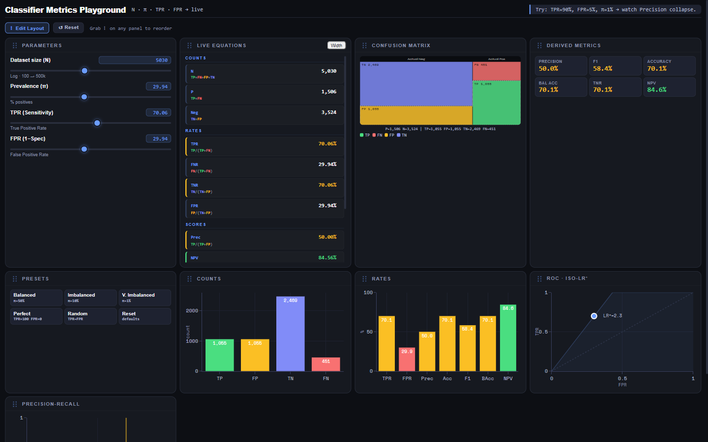

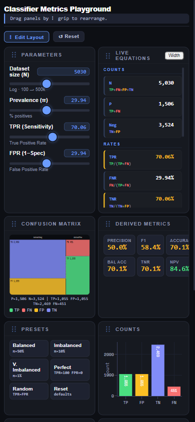

Additional pages opened in this branch:

| Path | Observed page | State | Desktop / phone evidence |
| --- | --- | --- | --- |
| dev/index.html | Metrics Playground (N, prevalence, TPR, FPR) | Rendered | [Desktop](screenshots/9503516-dev_index_html-desktop.png) · [Phone](screenshots/9503516-dev_index_html-mobile.png) |

### old_Release_Dark_Claude

**Identical old release homepage.** Family: Legacy movable dark dashboard. Commit: `ce97d3abbc8cf73f2db7ce70b60fcd42db58e289`. Commit date: 2026-03-07T22:43:44+01:00.

**What it does:** Same dark manual-rate movable dashboard and equation-width control as old_Release and old_movable.

**What is different:** Identical root index.html hash and rendered controls to those two branches; browser reorder, width change and refresh persistence all passed.

**Where it is useful:** Historical snapshot; no unique homepage capability was found.

**Caution:** The name suggests a separate dark redesign, but the actual root page is identical to the other two listed versions.

**Executed checks:** range ArrowRight; panel reorder + width change + refresh persistence (PASS).

**Layout:** initial document dimensions desktop 1440×900, phone 390×844; Body/internal scroll. These dimensions alone do not establish that every inner panel is visible.

[Local preview](http://localhost:8217/) · [Desktop full-size image](screenshots/ce97d3a-desktop.png) · [Phone full-size image](screenshots/ce97d3a-mobile.png)

### old_movable

**Original movable-layout snapshot.** Family: Legacy movable dark dashboard. Commit: `9a7762a423b099d988a20164583d5f9a4f1ae9f6`. Commit date: 2026-03-07T22:35:37+01:00.

**What it does:** Dark classifier dashboard whose grips reorder tiles and whose Width button cycles the equations tile width.

**What is different:** Root matches both old release variants. Moving Parameters after the matrix changed order, persisted after refresh, and Width changed class tile→tile span2.

**Where it is useful:** Smallest older source to inspect for drag ordering and persisted equation width.

**Caution:** This is button-based width/span resizing, not arbitrary corner-handle resizing.

**Executed checks:** range ArrowRight; panel reorder + width change + refresh persistence (PASS).

**Layout:** initial document dimensions desktop 1440×900, phone 390×844; Body/internal scroll. These dimensions alone do not establish that every inner panel is visible.

[Local preview](http://localhost:8222/) · [Desktop full-size image](screenshots/9a7762a-desktop.png) · [Phone full-size image](screenshots/9a7762a-mobile.png)

### old_claude_theme

**Rough earliest dark-theme prototype.** Family: Legacy movable dark dashboard. Commit: `5176eb167434a3ccffa285f6303985df2fbd6e4c`. Commit date: 2026-03-07T15:16:10+01:00.

**What it does:** Dark manual-rate classifier playground with parameters, matrix, derived metrics, presets, count/rate charts, ROC/PR and live equations.

**What is different:** No Edit Layout controls were exposed. A literal code-fence marker is visible in body text, and the desktop screenshot has uneven spacing and native-looking controls compared with later dark versions.

**Where it is useful:** Visual/history reference only.

**Caution:** Not a recommended implementation base; newer dark snapshots are more coherent and add real layout controls.

**Executed checks:** range ArrowRight; baseline controls and page inspection.

**Layout:** initial document dimensions desktop 1440×900, phone 386×1138; Page scroll. These dimensions alone do not establish that every inner panel is visible.

[Local preview](http://localhost:8219/) · [Desktop full-size image](screenshots/5176eb1-desktop.png) · [Phone full-size image](screenshots/5176eb1-mobile.png)

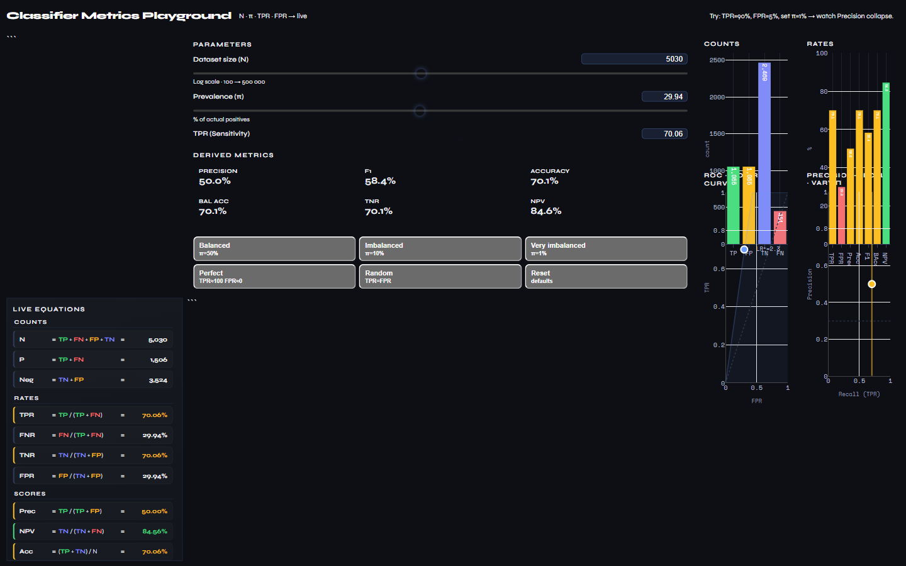

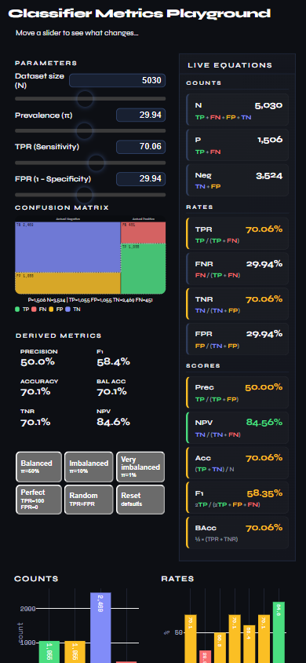

## Visual and runtime findings

- **All root homepages rendered.** Plotly and external fonts loaded in this run; there were no captured root page exceptions, failed requests or HTTP errors. This does not prove offline operation. The advanced/legacy families rely on CDN Plotly; the compact teaching line renders with inline SVG.
- **main/dev is not a full application.** It shows only “Metrics Dashboard”. Its linked /dev/css/styles.css returned HTTP404, verified separately. old_dev/dev is a full dashboard. The difference is easy to miss if reviewing only branch names or root screenshots.
- **Small viewport behavior varies strongly.** Advanced desktop branches often produce roughly 2,177px phone documents. mobile_view_rework shows one selected panel with pinned controls. Current compact versions show the matrix and score view together at 390×844.
- **Legacy body/internal scrolling matters.** main/old_dev initially report a viewport-height document, but the body has roughly 1,768px of content. The older movable/release versions have about 1,267px of body content. Their phone screenshots show only part of the dashboard; this is not equivalent to a fully fitting one-screen app.
- **old_claude_theme is rough.** A literal code-fence marker appears in body text. Controls and spacing are visibly less cohesive than later dark versions. Keep it as a historical reference.
- **Advanced direct mode intentionally decouples rates from score curves.** The manual ROC point may sit off the Gaussian curve and the app says so. Selecting linked/Gaussian or uploading real scores changes that interpretation. This is a conceptual difference from the compact deterministic-score teaching model, not a failed synchronization test by itself.
- **No inference from large blank areas alone.** Some screenshots show extra space, internal panels or clipped content. This review identifies those visually but does not claim a full overlap/accessibility/zoom audit of every historical layout.

### Measured initial layouts

| Version | Desktop scroll dimensions | Phone scroll dimensions | Phone behavior |
| --- | --- | --- | --- |
| Branch_1e973a51 | 1440×900 | 390×844 | Fits initial view |
| custom_data | 1440×900 | 386×2177 | Page scroll |
| feature_mosaic_improvments | 1440×900 | 386×2093 | Page scroll |
| feature_simple_bayes_story | 1440×900 | 390×844 | Fits initial view |
| feature_simple_bayes_story_overall_visual | 1440×900 | 390×844 | Fits initial view |
| feature_simple_hover_metrics / simple | 1440×900 | 390×844 | Fits initial view |
| featursimple_bayes_story_overall_visual_GemFixes | 1440×900 | 390×844 | Fits initial view |
| master | 1440×900 | 386×2177 | Page scroll |
| mobile_view_rework | 1440×900 | 390×844 | Fits initial view |
| refactor_big | 1440×900 | 386×2177 | Page scroll |
| simple_cld | 1440×900 | 390×844 | Fits initial view |
| custom_data_2000 | 1440×900 | 386×2177 | Page scroll |
| feature_simple_dragging_thr | 1440×900 | 390×844 | Fits initial view |
| main | 1440×900 | 390×844 | Body/internal scroll |
| mosaic_bounds | 1440×900 | 386×2177 | Page scroll |
| old_Release | 1440×900 | 390×844 | Body/internal scroll |
| old_Release_Dark_Claude | 1440×900 | 390×844 | Body/internal scroll |
| old_claude_improvments | 1425×1222 | 386×1937 | Page scroll |
| old_claude_theme | 1440×900 | 386×1138 | Page scroll |
| old_dev | 1440×900 | 390×844 | Body/internal scroll |
| old_from_scratch | 1425×1034 | 375×2768 | Page scroll |
| old_movable | 1440×900 | 390×844 | Body/internal scroll |

## Suggested development direction

1. Choose the compact teaching app as the user-facing base if the goal remains “help users understand classifier metrics immediately”. Preserve the 10%/50% base-rate comparison and five domain presets.
2. Bring over mobile_view_rework’s **navigation principle**, not the whole older state model: pinned controls and a selected lower panel are useful when screen height is limited.
3. If configurable panels are needed, study main/old_dev’s grips, span-width controls and localStorage persistence. Those behaviors were executed and work. Decide whether novices should see edit controls at all.
4. If real datasets become a core feature, treat it as a separate advanced mode using uploaded labels/scores and an empirical ROC. Preserve its distinction from illustrative Gaussian distributions and manual rates.
5. Study refactor_big’s math-core split and tests before extending any advanced model. Tests were discovered here, but this comparison does not rerun every historical suite.
6. Keep historical branches as references until desired features are deliberately ported and tested. No branch deletion, merge, reset, commit or push is suggested as an automatic outcome of this review.

## Evidence, reproducibility and limits

- [manifest.json](manifest.json): every ref, full SHA, commit description/date, exported paths, root hashes, external dependencies and preview port.
- batch-*.json: initial desktop/mobile DOM text, controls, graphs, dimensions, errors, interactions and screenshot names for all 22 tips.
- deep-*.json: 111 executed feature-action groups (111 PASS at their stated check scope; no failed action groups), model/import toggles, learning interactions, drag and persistence results. Passing a click check is not numerical certification of its entire feature.
- secondary-*.json: 28 additional entry points, including development/archive pages and educational/reference documents.
- [specific-comparisons.json](specific-comparisons.json): axis-switch gesture, Bayes inputs, four mobile tabs, Advanced controls and confirmed missing stylesheet404.
- [screenshots/](screenshots/): 167 screenshots. Main desktop/mobile images were reviewed in contact sheets, with selected full-size pages inspected separately. Secondary pages were opened and captured; not every secondary screenshot received a full manual layout audit.
- [contact-sheets/](contact-sheets/): all root desktop/mobile screenshots in eight labeled overview sheets.
- export-and-serve.cjs reproduces committed web assets without checking out branches. build-browser-harness.cjs / review.playwright.js, build-deep-harness.cjs / deep.playwright.js and build-secondary-harness.cjs / secondary.playwright.js reproduce the MCP browser campaign in batches.

The current branch stayed `featursimple_bayes_story_overall_visual_GemFixes` at `4ad5b18ff465358ac25b538f50dc2e068f7cb644`. No tracked application files were edited, and no commits, pushes, merges or branch switches were performed. Existing untracked CA_MATRIX_DEVELOPMENT_PLAN.md and earlier test-results were preserved. git fetch refreshed remote metadata only; git ls-remote confirmed the remote heads.

Coverage limits: Chromium only in this comparison; two representative viewport sizes; no full mathematical regression suite across 22 histories; no physical devices, screen-reader/contrast audit, exhaustive upload-boundary matrix, security audit or deployment validation. The earlier full QA applies to its recorded current-branch SHA and should not be generalized to other branches.
